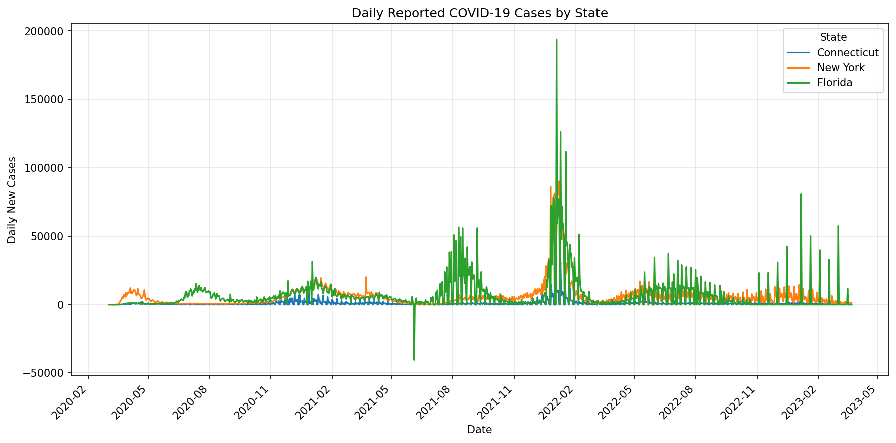
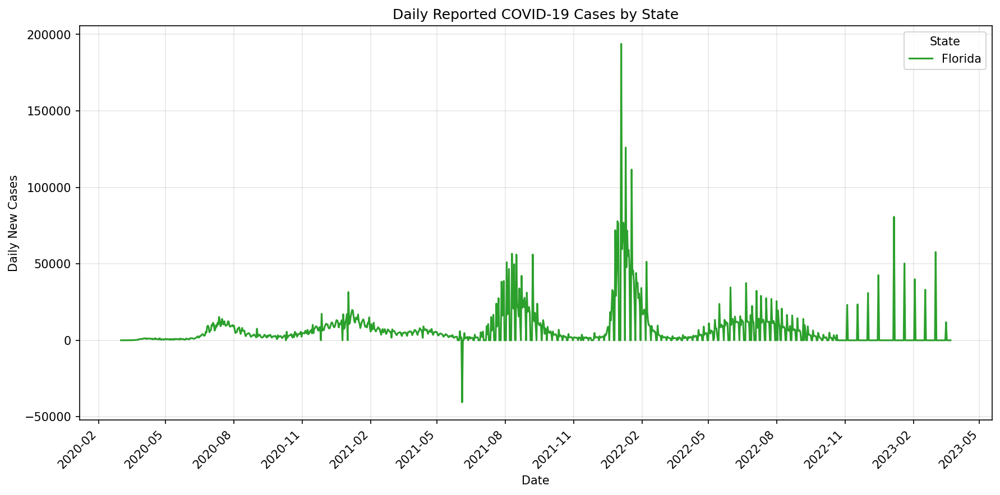

# BIS/CBB 634 — Fall 2026 Portfolio

**Name:** Liam Lian  
**NetID:** xl758  
**Course:** Computational Methods for Informatics

This repository collects studio work and subsequent portfolio development for the course.

## Studio 1 — Exercise 1: COVID-19 case data

The analysis loads cumulative state-level counts, calculates daily reported changes, compares state trends and peak dates, and investigates Florida reporting anomalies.

### Code and outputs

- [Jupyter notebook](studio-01-covid.ipynb): executable Python code and saved outputs for tasks 1a–1e.
- [Overlaid state plot](daily_cases.png).
- [Florida plot](florida_daily_cases.png).
- [Data download helper](download_data.py): retrieves and verifies the input file.

The notebook is the maintained analysis source. The supplied assignment does not explicitly require a `.py` extension; its references to code and scripts are implemented here as Python notebook cells.

### Reproduce the analysis

From the repository root, in a Python environment with pandas, matplotlib and Jupyter installed:

```bash
python download_data.py
jupyter notebook studio-01-covid.ipynb
```

Restart the notebook kernel and run all cells in order. The download helper uses only the Python standard library. It writes `covid-19-data-master/us-states.csv`, preserving the notebook's relative path, and verifies SHA-256 before accepting the file. The full upstream archive is retained locally but excluded from this repository; only state-level data is needed here. Existing matching data can be used without downloading again.

### Data source and preparation — 1a

Data source: **The New York Times**, [Coronavirus (Covid-19) Data in the United States](https://github.com/nytimes/covid-19-data), specifically [us-states.csv](https://github.com/nytimes/covid-19-data/blob/master/us-states.csv). Consult the upstream [README](https://github.com/nytimes/covid-19-data/blob/master/README.md) and [license](https://github.com/nytimes/covid-19-data/blob/master/LICENSE) for methodology and usage terms. The upstream project states that daily case/death updates stopped March 24, 2023.

The analyzed snapshot contains 61,942 rows across 56 state/territory-level labels, spanning January 21, 2020 through March 23, 2023. `cases` and `deaths` are cumulative reported counts. Dates are parsed as datetime values, and FIPS codes remain strings so leading zeros are retained.

Rows are sorted by state and date. `groupby("state")["cases"].diff()` computes daily changes once during preparation. `daily_cases` uses pandas nullable `Int64`: each group's first record has no prior observation and stays missing, producing 56 missing differences. Missing values are not replaced with zero. Negative changes are retained as possible reporting revisions.

Input SHA-256: `0b202f6ac8bad66b70b9e344c07155e3f1ce9338f86192af072b56ce448dfc43`.

### State trends — 1b

`plot_daily_cases(data, states)` overlays selected states. Connecticut is blue, New York orange, and Florida green in the example. Florida's standalone plot is explicitly recolored green for consistency. Date labels use `YYYY-MM`, spaced every three months and rotated for readability.



These are absolute reported changes, not population-adjusted rates. Reporting delays and revisions can create spikes or negative values; the curves do not directly measure infection dates. Raw daily values preserve these patterns but are noisy, and larger spikes compress smaller curves on the shared axis.

### Peak dates and comparison — 1c–1d

`find_peak_date(data, state)` selects the date of the largest daily change. Sorting by date means ties resolve to the earliest occurrence. `compare_peak_dates(data, state1, state2)` compares the two dates and returns the absolute number of elapsed days while printing which state peaked first.

| State | Peak report date | Daily reported change |
| --- | --- | ---: |
| Connecticut | 2022-01-10 | 31,405 |
| New York | 2022-01-08 | 90,132 |
| Florida | 2022-01-04 | 193,786 |

The notebook's Connecticut–Florida example finds that **Florida peaked 6 days before Connecticut**. This comparison concerns peaks in reported increments; it does not establish the ordering of actual infection peaks.

### Florida anomalies — 1e



I noticed one negative daily change in Florida's case data: −40,527 on June 4, 2021. This might reflect a revision or correction to previously reported cumulative counts.

I also noticed three consecutive days with zero reported increase immediately before the peak. From January 1 through January 3, 2022, the cumulative count stayed at 4,166,392. On January 4, it increased by 193,786, producing the largest daily increase in the dataset for Florida.

My hypothesis is that reporting may have been delayed during the New Year's holiday period, with cases from the preceding days reported together on January 4. If so, the peak could partly reflect a reporting backlog rather than infections occurring on a single day. The three zero increases describe unchanged reported totals, not necessarily an absence of new cases. This holiday-related explanation is a hypothesis based on the pattern; I have not verified the reporting schedule.

### Code evolution and design choices

Development began with loading and inspecting the CSV, followed by plotting and peak-comparison functions. Dates were explicitly parsed and FIPS codes stored as strings. The date-axis format was revised to `YYYY-MM`, and the standalone Florida plot was changed to match its color in the combined plot.

After noticing that `.diff()` produced floats, Liam proposed calculating `daily_cases` once in the initial preparation cell and reusing it throughout. The current implementation adopts that change and uses nullable integers to retain the missing first observation. This centralizes the transformation and avoids repeated computations. The saved notebook still includes a redundant initial CSV read and a repeated definition of the comparison function; these are cleanup opportunities rather than separate analytical methods.

The functions accept the prepared DataFrame explicitly. They depend on the preparation cell having run first. Keeping raw differences makes reporting artifacts visible; no smoothing, clipping, population normalization, or redistribution across reporting dates is performed. Invalid state names are checked, but broader input validation remains limited.

### Validation and remaining work

- Saved notebook outputs demonstrate execution of the analysis in the student's Jupyter session.
- A separate standard-library CSV calculation reproduced all three peak values/dates, Florida's zero and negative counts, and the six-day comparison. It also verified consecutive dates within every state/territory series.
- A fresh automated notebook rerun in the assistant's environment could not complete because local Python environments failed during dependency loading. No successful clean-kernel rerun is claimed here.
- This is the first uploaded working version, not evidence of a historical in-class commit. Exercise 2 remains to be completed before portfolio review. Repository sharing and the exit ticket are separate course tasks and are not verified by this upload.

### AI assistance

OpenAI Codex supplied draft plotting, peak-finding, comparison, and anomaly-inspection code; explained data types and cumulative counts; and assisted with documentation, independent numerical checks, and upload preparation. Liam ran the notebook and requested the date-format change, consistent Florida coloring, and centralized daily-case calculation. The README is an AI-assisted draft grounded in those exchanges and saved outputs. Liam remains responsible for reviewing the explanations and being able to explain and defend the code. Independent mastery is not inferred from successful execution.
