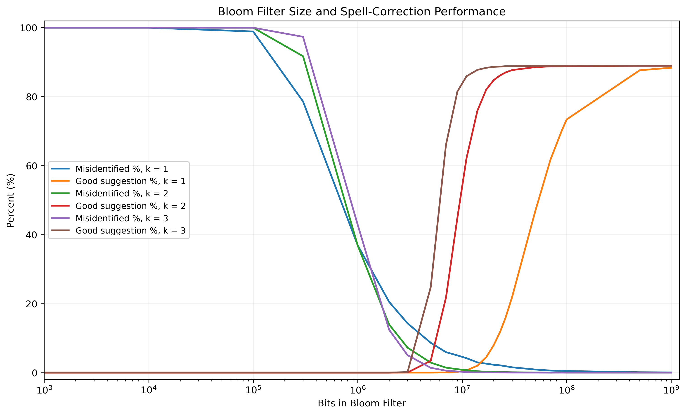

# Studio 3 — Big Data

[Back to course portfolio](../README.md)

**Course:** BIS/CBB 634 — Computational Methods for Informatics, Fall 2026<br>
**Author:** Liam Lian (xl758)

This folder contains the Studio 3 Bloom filter exercise: vocabulary reconstruction, empirical spell-correction evaluation, and analysis of capacity, mutation spaces, and hash-function choices.

The implementation and plotting cells are in [big-data-exercises.ipynb](big-data-exercises.ipynb); parallel workers and checkpoint handling are in [part2_parallel.py](part2_parallel.py). To run the notebook, use Python with Jupyter, `bitarray`, and `matplotlib`. Place the assigned [words.txt](https://github.com/dwyl/english-words/blob/master/words.txt) and course-provided `typos.json` beside the notebook; input files are not included in this repository. Run the notebook cells in order from this directory. The plotting cell can also read the saved CSV without rerunning the sweep.

## Part 1: Algorithmic Mechanics & Data Reconstruction Leakage

Implementation: [big-data-exercises.ipynb](big-data-exercises.ipynb).

The function `suggest_corrections(typed_word: str, bloom_filter: BloomFilter) -> list[str]` generates all single-character substitutions using lowercase letters a–z, excluding the original character at each position. It queries each candidate in the Bloom filter and returns those that test positive. For `floeer`, this produces 150 candidates before filtering.

### 1. Reconstruction Analysis

The Bloom filter's bit vector stores no raw text, ASCII values, or string pointers, but it still reveals information about membership in the protected vocabulary. An adversary can generate candidate mutations of known or suspected words and query the filter. The same hash functions map each candidate to positions in the bit array. If any corresponding bit is zero, the candidate is definitely absent; if all are one, it is possibly present. By repeating this process, an adversary can eliminate candidates and narrow down which words may be in the database without directly reading its contents.

This is a form of data leakage because membership information itself reveals something about the protected data. The filter acts as a membership oracle: combined with linguistic patterns or domain knowledge, its responses can help reconstruct portions of the protected vocabulary. This does not require reversing the hashes or extracting strings from the bit vector. However, reconstruction may be incomplete or inaccurate because false positives can admit absent words, and words outside the generated candidate set remain undiscovered. Not storing raw text therefore does not eliminate the possibility of inference through queries.

### 2. Execution Test

I loaded `words.txt` into three Bloom filters, each with `size=10**7` bits (approximately 1.25 MB of bit storage). The filters use the first hash function, the first two, and all three, respectively. Each filter uses one shared bit array and the same input word list. I tested the correction function with `"floeer"`.

The following code uses the supplied `BloomFilter` class and the `words` list loaded from `words.txt`:

```python
bf1 = BloomFilter(size=10**7, hash_count=1)
bf2 = BloomFilter(size=10**7, hash_count=2)
bf3 = BloomFilter(size=10**7, hash_count=3)

for word in words:
    bf1.add(word)
    bf2.add(word)
    bf3.add(word)

import string

def suggest_corrections(
    typed_word: str,
    bloom_filter: BloomFilter
) -> list[str]:
    word = typed_word.lower()
    suggestions = []

    for i in range(len(word)):
        for letter in string.ascii_lowercase:
            if letter == word[i]:
                continue

            candidate = word[:i] + letter + word[i + 1:]

            if candidate in bloom_filter:
                suggestions.append(candidate)

    return suggestions

print(suggest_corrections("floeer", bf1))
print(suggest_corrections("floeer", bf2))
print(suggest_corrections("floeer", bf3))
```

The saved notebook outputs are:

**First hash function — SHA-256:**

```text
['bloeer', 'qloeer', 'fyoeer', 'flofer', 'floter', 'flower', 'floeqr', 'floees']
```

**First and second hash functions — SHA-256 and BLAKE2b:**

```text
['fyoeer', 'floter', 'flower']
```

**All three hash functions — SHA-256, BLAKE2b, and SHA3-256:**

```text
['floter', 'flower']
```

Increasing the hash count reduced false positives in this experiment because a candidate must pass every selected bit check. With one hash function, an absent word such as `bloeer` can pass when its position was set by another word. Additional hash functions require more corresponding positions to be one: `bloeer` is eliminated with two hashes, and `fyoeer` is eliminated with three. Inserted words still pass because their corresponding bits were set during insertion. A positive result remains probabilistic; zero false positives for this test does not guarantee zero false positives for other inputs. More hashes are not always better, since they also set more bits during insertion and can eventually make a fixed-size array too full.

## Part 2: Empirical Evaluation & Plotting

### 1. Metrics Definition

The evaluation dataset contains 50,000 pairs of `[typed_word, correct_word]`, including 25,000 pairs with different input and target strings. Both metrics reuse the same vocabulary from `words.txt`.

- **Misidentified Percent:** 100 times the number of typo inputs accepted by the Bloom filter, divided by the 25,000 typo cases. Correctly spelled inputs are excluded from this denominator. This follows the assignment's typo-based definition.
- **Good Suggestion Percent:** 100 times the number of cases whose suggestion list contains at most three entries and includes `correct_word`, divided by all 50,000 cases. The other suggestions need not all be real words to satisfy this definition. Lists are not truncated to three before scoring.

Part 1's function remains unchanged. For Part 2, `suggest_corrections_part2` generates the same substitutions and adds the original lowercased word once if it passes the Bloom filter. This handles correctly spelled inputs without using the answer to generate suggestions. `correct_word` is used only for scoring. A mistyped original word that passes as a false positive is also included. This is my explicit evaluation convention for the full dataset.

The additional block in `suggest_corrections_part2` appears after the substitution loops and immediately before `return suggestions`:

```python
    # Include the original word once if it passes the Bloom filter.
    if word in bloom_filter:
        suggestions.append(word)

    return suggestions
```

The metric calculations below use the full `typos` dataset and its separately filtered typo subset. `suggest_corrections_part2` is defined above in the notebook.

```python
typo_pairs = [
    (typed_word, correct_word)
    for typed_word, correct_word in typos
    if typed_word != correct_word
]

def misidentified_percent(typo_pairs, bloom_filter):
    if len(typo_pairs) == 0:
        return None

    false_positive_count = 0

    for typed_word, correct_word in typo_pairs:
        if typed_word in bloom_filter:
            false_positive_count += 1

    return false_positive_count / len(typo_pairs) * 100

def good_suggestion_percent(typos, bloom_filter):
    if len(typos) == 0:
        return None

    good_count = 0

    for typed_word, correct_word in typos:
        suggestions = suggest_corrections_part2(
            typed_word, bloom_filter
        )

        if len(suggestions) <= 3 and correct_word in suggestions:
            good_count += 1

    return good_count / len(typos) * 100
```

### 2. Parametric Plotting and Parallel Architecture

The final sweep evaluates 23 filter sizes from 1,000 to 1,000,000,000 bits with hash counts 1, 2, and 3: **69 independent configurations**. Each configuration rebuilds its filter from the same word list and computes both metrics on the same evaluation data.

[part2_parallel.py](part2_parallel.py) distributes whole `(filter_size, hash_count)` configurations across three reusable worker processes. Each worker loads the inputs once, owns its filter, and returns a small result record. The main process collects completed tasks and atomically saves the CSV and checkpoint; workers share neither a mutable bit array nor output files.

The checkpoint verifies input and code hashes before reusing completed configurations. This allowed additional sizes to be tested without rerunning retained points. Narrowing the grid discards unrequested points from the rewritten checkpoint; changed inputs or code require a fresh run. The trade-off is worker-local memory: a one-billion-bit array alone occupies about 125 MB. No serial-versus-parallel speedup was measured. The supplied `_get_hashes` computes all three digests before slicing, so selecting fewer hashes does not avoid those digest computations.

**Final experimental results:** [CSV](part2-results-parallel.csv). The notebook contains the exact parameter grid and plotting code; the [checkpoint](part2-results-parallel.checkpoint.json) supports resuming with matching local inputs and code.



The six lines connect measured values on a logarithmic horizontal axis; no smoothing or fitted curve was applied. Larger filters generally reduce misidentification and improve the Good Suggestion percentage. Two and three hashes reach high suggestion quality with much less space than one hash. At one billion bits, the Good Suggestion percentages are 88.408%, 88.964%, and 88.966% for one, two, and three hashes. The plateau is an observed result; a case-level failure analysis has not been performed, so its exact causes are not established here.

## Part 3: Deep Dive & Critical Analysis

### 1. Filter Capacity Threshold

The saved empirical results bracket the 85% Good Suggestion threshold as follows:

| Hash count | Last tested point below 85% | First tested point at or above 85% | Observed crossing interval (bits) |
| ---: | ---: | ---: | ---: |
| 1 | 100,000,000 bits: 73.412% | 500,000,000 bits: 87.670% | 100,000,000–500,000,000 |
| 2 | 20,000,000 bits: 84.784% | 23,000,000 bits: 86.160% | 20,000,000–23,000,000 |
| 3 | 9,000,000 bits: 81.496% | 11,000,000 bits: 85.932% | 9,000,000–11,000,000 |

Among the tested configurations, the smallest sizes achieving at least 85% are therefore **500 million, 23 million, and 11 million bits** for one, two, and three hashes, respectively. These are measured sufficient sizes, not exact minimum thresholds. The one-hash interval is especially wide because of sparse sampling there; additional points would be needed for a tighter estimate. The comparison shows that, in this experiment, extra hash checks substantially reduce the storage needed to reach the target.

### 2. Combinatorial Explosion & Mutation Spaces (Edit Distance vs. K-mers)

One substitution generates `25L` candidates for a lowercase word of length `L`; two substitutions at distinct positions generate `C(L, 2) * 25**2`. At `L = 6`, this increases the candidates from **150 to 9,375**. Insertions, deletions, and transpositions add possibilities and duplicate edit paths. For a fixed alphabet and at most two edits, candidate counts grow roughly quadratically with length; increasing the allowed edit depth causes much faster branching growth.

More candidates mean more work and more opportunities for false positives: `Q` absent queries with false-positive probability `p` yield about `Qp` false positives in expectation. The per-query probability does not increase merely because more queries are made. Genuine-word ambiguity also matters: even an exact membership test may return more than three valid words. A larger edit radius can recover missed targets while also making suggestion lists less selective.

For DNA's four-letter alphabet, one substitution generates `3L` candidates. A read contains overlapping k-mers: for example, `ACGTAC` contains the 3-mers `ACG`, `CGT`, `GTA`, and `TAC`. Here k is substring length, not hash count. One sequencing error can affect several overlapping k-mers, and multiple edits enlarge the candidate space. A Bloom filter can screen candidate k-mers efficiently, while repeats, true biological variants, and sequencing errors require alignment, base-quality information, or neighboring context to resolve. [Background on k-mers](https://pmc.ncbi.nlm.nih.gov/articles/PMC11874746/)

### 3. Cryptographic vs. Non-Cryptographic Hash Efficiency

Ordinary membership filtering needs fast, deterministic hashes with well-distributed positions and low dependence between outputs. SHA-256, BLAKE2b, and SHA3-256 also provide cryptographic properties that can add computational cost. Non-cryptographic alternatives such as MurmurHash3 or xxHash are worth evaluating, but no replacement-hash speed or accuracy benchmark was performed here. [NIST hash properties](https://csrc.nist.gov/glossary/term/Cryptographic_hash_function), [xxHash design](https://xxhash.com/)

Cryptographic collision resistance does not prevent Bloom filter false positives: reducing digests modulo the bit-array size creates shared positions, and multiple inserted words can collectively set every queried bit. Nor does it hide this vocabulary: an adversary can hash candidate words and query membership without inverting a digest. For this public, unkeyed implementation, cryptographic strength therefore supplies neither confidentiality nor an automatic accuracy advantage over suitable non-cryptographic hashes.

---

## Code evolution and design choices

I began with the supplied Bloom filter and used nested loops to generate single-character substitutions. I excluded the original letter at each position and queried candidates as they were generated, keeping only those that passed. This avoided storing the full candidate set, at the cost of regenerating it for each filter configuration. An initial test used `floter` instead of `floeer`; correcting the input resolved the mismatch with the exercise's example outputs.

For Part 2, I separated the two metric denominators: misidentification uses only typo cases, while Good Suggestion uses all evaluation cases. I kept Part 1 unchanged and created `suggest_corrections_part2`, which includes the original word once only if it passes the filter. This avoids duplicate original words and handles correctly spelled inputs without consulting the ground-truth answer. I used counters rather than retaining every case's result, and scored the full suggestion list without truncating it to three.

I expanded the experiment to 23 sizes and three hash counts, using Codex's three-worker implementation and checkpoints to add points near transitions and extend the one-hash curve to one billion bits. I combined both metrics in a six-line graph with a logarithmic size axis, preserving measured points without smoothing. I reported the first qualifying sizes and crossing intervals rather than exact unmeasured thresholds. The observed plateau remains unexplained without a case-level failure analysis.

## AI assistance

I used OpenAI Codex to assist with code generation, README writing, debugging, and code maintenance. We discussed candidate generation, metric denominators, handling correctly spelled inputs without using the answer, parallel execution, checkpoint reuse, graph design, and the interpretation of capacity thresholds. I ran the full experiment, expanded the parameter grid, and reviewed the outputs. I contributed the reasoning about genuine-word ambiguity and hashing trade-offs; Codex helped refine the complexity terminology and explain k-mers and cryptographic hash properties where I needed guidance.

Codex implemented the process-pool and checkpoint structure, helped express the analysis, and checked the 69 saved records against the checkpoint, input and code hashes, and reported threshold values. Small synthetic tests checked agreement between the parallel implementation and notebook calculations; the complete sweep was not independently rerun during the documentation update. I made the overall decisions through this discussion and retained responsibility for understanding and verifying the final work.

For the portfolio-feedback revision, Codex shortened repeated implementation and interpretation details while retaining the saved results, metric definitions, threshold table, and limitations. The Bloom filter experiment was not rerun for this editorial revision.
