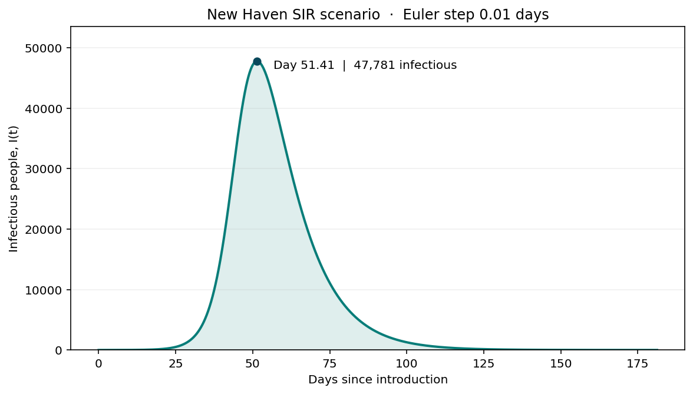
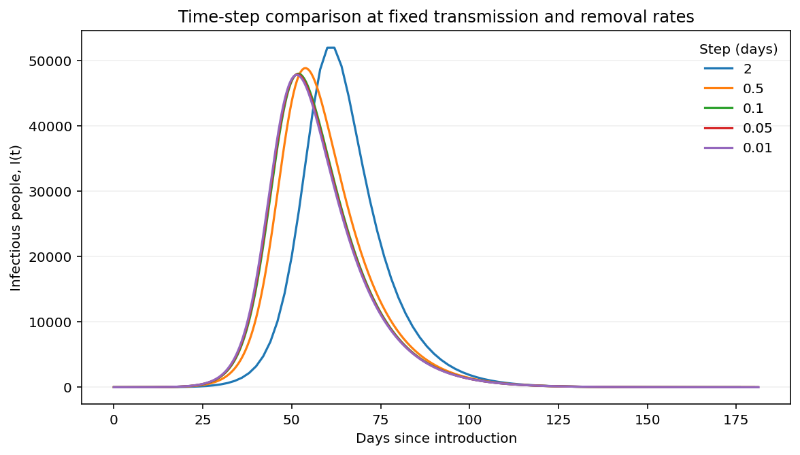
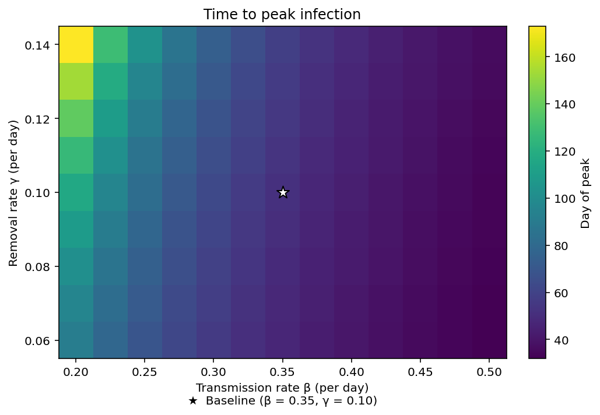
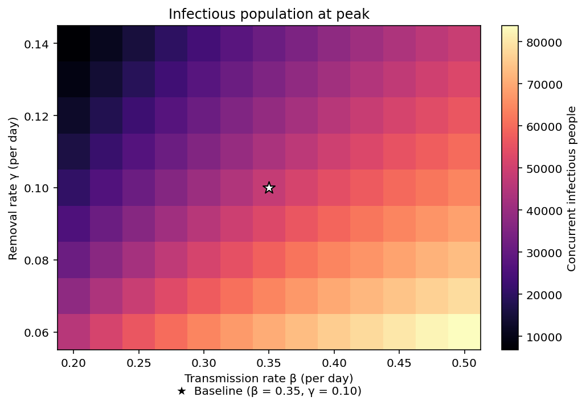

# Studio 6 — Calculus and iterative algorithms

[Back to course portfolio](../README.md)

**Course:** BIS/CBB 634 — Computational Methods for Informatics, Fall 2026

**Author:** Liam Lian (xl758)

This folder contains a population-level SIR simulation and a two-dose optimization experiment using the course simulation API. Both computational pipelines have been run. The written interpretation and reflection prompts are reserved for the author's review and independent responses.

## Exercise 1 — SIR models

### Part 1 — Custom solver and baseline simulation

The baseline reached **47,780.91 concurrently infectious people on day 51.41**. Infection first fell below one person on day 181.25. The plotted line includes every Euler step from introduction through clearance.



The simulation uses the 2020 census count of **134,023** for New Haven city as a fixed population, with the index case counted inside that total. It assumes one infectious person and zero prior removals, giving initial counts of 134,022 susceptible, 1 infectious and 0 removed. The rates are β = 0.35/day and γ = 0.10/day. These are scenario inputs for a novel pathogen. [U.S. Census Bureau, 2020 Census Table P1](https://data.census.gov/table/DECENNIALPL2020.P1?g=160XX00US0952000)

The [solver](sir.py) updates all compartments from the same previous state. Here h is the time increment in days. The function returns the full time series, retains fractional counts, and raises an error if a step produces a negative population.

```python
new_infections = beta * S * I / N * h
new_removals = gamma * I * h
S_next = S - new_infections
I_next = I + new_infections - new_removals
R_next = R + new_removals
```

The [analysis script](sir_analysis.py) extracts the peak using the row with the largest I and identifies clearance from the first row with I < 1. The [compact trajectory](baseline.csv) contains the integer days, peak and clearance. The figure uses the full trajectory. Reproduce all SIR outputs by running `python sir_analysis.py` here with NumPy, Pandas and Matplotlib installed.

### Part 2 — Step-size validation and peak extraction

The finer comparison run (dt = 0.005 days) peaked on day 51.39 at 47,770.37 people. Each candidate was compared with it over the shared observation period. The maximum curve error is the largest absolute vertical difference after linear interpolation, divided by the finer run's peak.

| Step (days) | Peak day | Peak infectious | Clearance day | Maximum curve error |
| ---: | ---: | ---: | ---: | ---: |
| 2.00 | 62.00 | 51,951.73 | 176.00 | 62.08% |
| 0.50 | 54.00 | 48,826.90 | 180.00 | 18.81% |
| 0.10 | 51.90 | 47,970.92 | 181.00 | 3.70% |
| 0.05 | 51.60 | 47,865.30 | 181.15 | 1.76% |
| 0.01 | 51.41 | 47,780.91 | 181.25 | 0.20% |

The selection rule uses the largest candidate with peak timing within 0.25 days, peak magnitude within 0.5%, and maximum curve error within 1%. Only dt = 0.01 met all three criteria. A separate 20-day stress run produced a negative compartment at day 140 and the solver rejected that step. The baseline basic reproduction number is β/γ = 3.5. [Full validation metrics](step-validation.csv)



### Part 3 — Parameter uncertainty and sensitivity

The 13 × 9 grid varies β from 0.20 to 0.50/day in steps of 0.025 and γ from 0.06 to 0.14/day in steps of 0.01. These illustrative ranges surround the baseline, with mean infectious periods of roughly 7.1 to 16.7 days. Initial counts and dt = 0.01 stay fixed. Across 117 runs, peak times range from 31.85 to 172.97 days and peak counts range from 6,746.89 to 83,879.70. Halving the step at all four grid corners changed peak timing by at most 0.03 days and peak magnitude by less than 0.032%. [Full grid results](sensitivity.csv)





**Independent writing for review.** Part 1 asks for a defense of the initial conditions. Part 2 asks how to judge step adequacy and instability, how peak and cumulative infection differ for planning, and how the susceptible threshold relates to peak timing. Part 3 asks for interpretation of sensitive regions and intervention effectiveness using the heatmaps.

### Exercise 1 — Code evolution and design choices

The first solver check followed one person through a single update in a synthetic population of 1,000. The same solver now runs each scenario. A separate driver extends the horizon if necessary and applies one clearance rule to every curve. This keeps peak extraction and population comparisons consistent across the step study and grid.

### Exercise 1 — AI assistance

I used OpenAI Codex for code development, execution, figure generation and documentation. Codex selected the census-based scenario, numerical tolerances and grid for review, checked mass conservation and the clearance crossing, and compared the baseline peak with the continuous SIR model. The independent written responses are outstanding.

## Exercise 2 — In silico synergy optimization

### Part 1 — API architecture and request handling

The [optimization script](optimize.py) sends a GET request to the course endpoint at `/cgi-bin/error_function.py` with dose coordinates in the query parameters `a` and `b`. The response body contains one numerical disease-burden score. The client identifies itself with a course-specific User-Agent, spaces live requests at least one second apart within a run, checks the HTTP response and keeps a persistent cache. An empty score in the [request ledger](api_scores.csv) records a failed request and counts toward the budget.

Run `python optimize.py` here with NumPy and Requests installed to reproduce the search from the ledger. This default uses zero new API requests. The explicit `--live` option retrieves missing values within the shared budget.

### Part 2 — Custom bounded gradient descent

For each axis, the solver estimates the slope from the change in burden over a dose increment of 0.00001, reusing the current score. It uses a backward difference near the upper bound. Each descent step projects both doses into [0, 1].

```python
trial = np.clip(x - step * grad, 0, 1)
trial_value = score(trial)
```

The initial learning rate is 0.15. Subsequent steps use the displacement and change in gradient to estimate a learning rate when their inner product is positive. Backtracking halves a trial step until it gives sufficient decrease. The script checks the projected gradient norm against 0.0001, caps each start at 40 iterations, and shares a 150-request ceiling across starts. All four starts reached the gradient criterion after two accepted steps.

### Part 3 — Multi-start search and optima

| Initial (a, b) | Final (a, b), rounded | Disease burden | Additional distinct doses |
| --- | --- | ---: | ---: |
| (0.40, 0.20) | (0.7120, 0.1690) | 1.00000000015 | 9 |
| (0.80, 0.80) | (0.2160, 0.6890) | 1.10000000005 | 9 |
| (0.15, 0.85) | (0.2160, 0.6890) | 1.10000000005 | 6 |
| (0.85, 0.15) | (0.7120, 0.1690) | 1.00000000015 | 6 |

The course specifies one global and one suboptimal local minimum. Under that specification, the basin near **(0.712, 0.169)** is the global minimum and the basin near **(0.216, 0.689)** is the higher local minimum. Finite differences identify both coordinates approximately. The four trajectories alone establish which observed score is lower. [Accepted trajectories, scores and stopping diagnostics](optimization.json)

**Independent writing for review.** Part 1 asks about the URL and REST design, standardization across platforms, Reduction, and server etiquette. Parts 2 and 3 ask for a defense of the learning rate, bounds, stopping rule and multi-start coverage under a query budget. The final reflection asks when the experimental evidence would justify advancing a candidate.

### Exercise 2 — Code evolution and design choices

The endpoint was first checked at (0.4, 0.2), then that result was reused as the first starting score. All four starts use the same solver and cache. One interrupted connection during the third start was recorded and the run resumed from saved evaluations. The completed search used **30 distinct evaluated doses in 31 request attempts**.

### Exercise 2 — AI assistance

I used OpenAI Codex to implement the projected gradient search, select starting points and numerical settings, run the live API experiment, verify offline replay, and document the observed minima. The assignment's independent discussion and methodological reflection remain for me to write.
