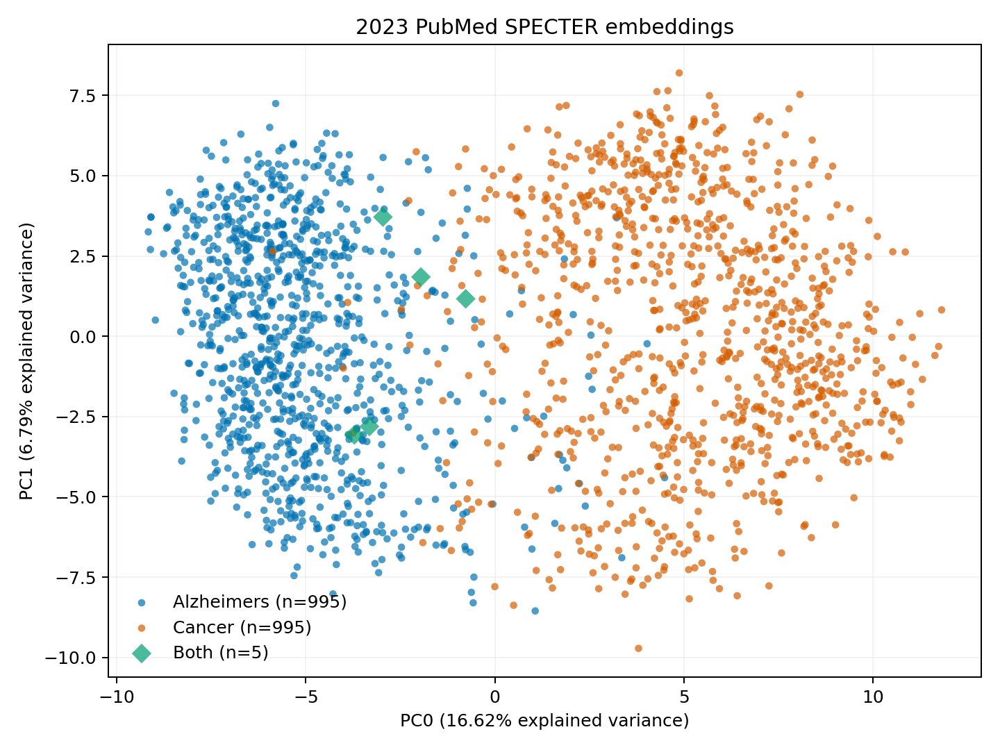
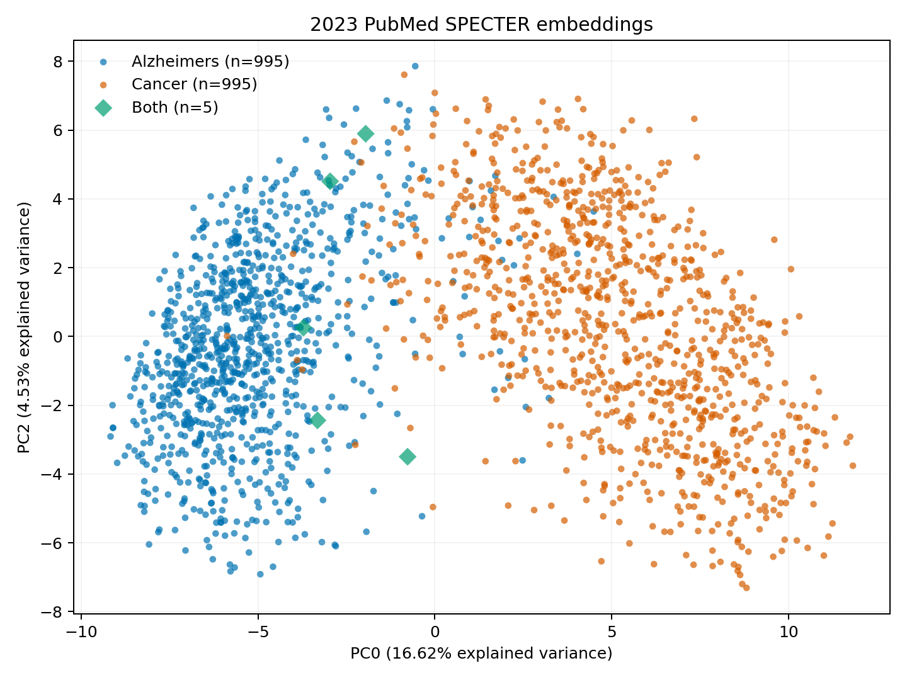
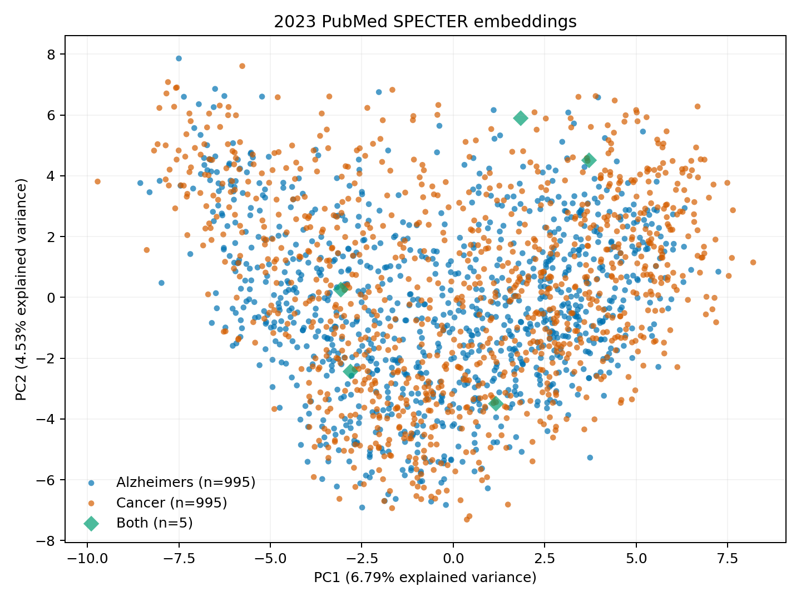
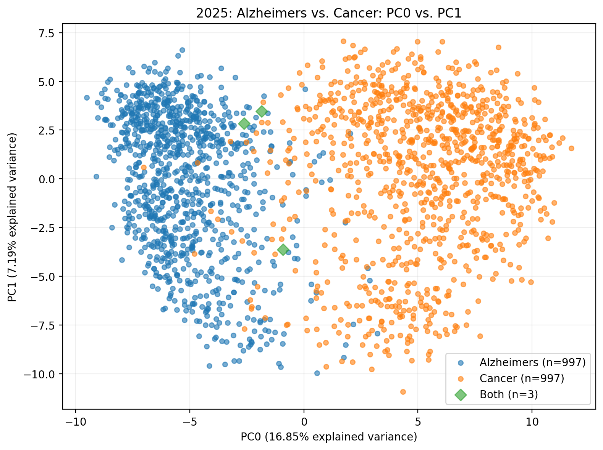
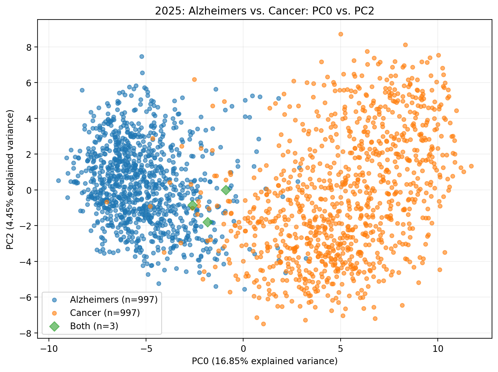
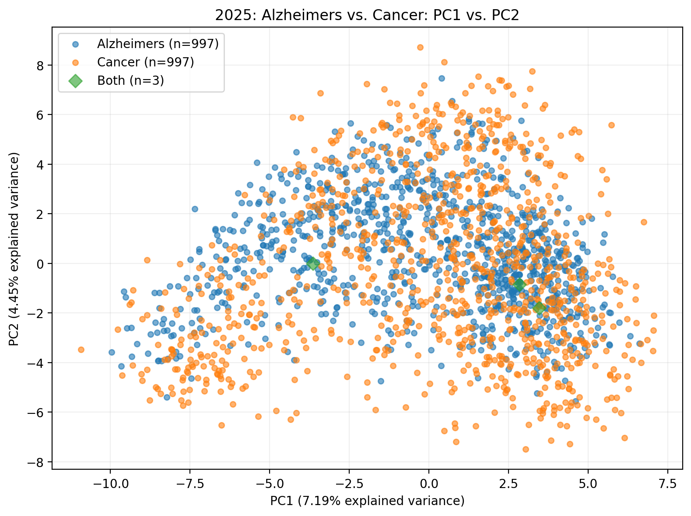

# Data exploration 2 — PubMed embeddings and PCA

[Back to course portfolio](../README.md)

**Course:** BIS/CBB 634 — Computational Methods for Informatics, Fall 2026  
**Author:** Liam Lian (xl758)

This folder explores instructor-provided 2023 PubMed embeddings and implements a configurable pipeline that retrieves 2025 papers, generates SPECTER embeddings, and visualizes three principal components. The discussion below consolidates my observations and our AI-assisted discussion; the assistance is described at the end.

## Code and outputs

- [Working notebook](data-exploration.ipynb): both Parts, saved outputs, interactive plots, and PMID-based paper inspection.
- [2025 search record](pubmed_search_2025.json): retrieval timestamp, search settings, and the selected PMID lists.
- [2025 interactive 3D plot](part2-2025-pca-3d.html): download and open locally to rotate the plot and inspect PMIDs and titles. GitHub does not execute the HTML preview.
- The six required component-pair plots are embedded below.

The notebook is the maintained implementation. The earlier `part1.py`, its CSV, and its variance JSON are local development artifacts, not an alternative maintained pipeline. The existing 2023 PNG exports were produced during that earlier development; the notebook independently contains the same component-pair visualizations with slightly different styling.

### Reproduction

1. Obtain the instructor's `papers.json` and `embeddings.db` from Canvas and place them beside the notebook. These course inputs are not distributed as repository downloads. Open the shelf with the base name `embeddings` on the original macOS environment.
2. Use a Jupyter kernel with `numpy`, `requests`, `torch`, `transformers`, `scikit-learn`, `matplotlib`, `pandas`, `tqdm`, and `plotly`. Set the Part 1 `folder` and Part 2 `FOLDER` paths to the exercise directory on your machine. The saved run reports Python packages including PyTorch 2.14.1, Transformers 5.20.1, and scikit-learn 1.6.1.
3. Run Part 1 in order. Its optional paper-inspection cell prompts for a PMID; skip it when proceeding directly to Part 2. In Jupyter, use `%matplotlib inline` if an earlier session selected a noninteractive backend.
4. For Part 2, run the configuration cell, then the numbered cells in order. Existing search and metadata files are reused. Without them, the pipeline queries PubMed and downloads the metadata. Model loading requires an initial Hugging Face download unless the model is cached.
5. The embedding step resumes from a local shelf, then the analysis reads it back and saves the plots. Keep the matching metadata and embedding manifest together with the shelf. Shelve backends can vary across Python environments; regenerate the 2025 shelf locally if moving it between incompatible environments.

The default configuration is 2025, `Alzheimer's disease` and `Cancer`, 1,000 results per query, publication-date sorting, retrieval batches of 100, and embedding batches of 8. Inputs are truncated to 512 tokens including special tokens. Changing the year or terms creates separate filenames; changing `RUN_TAG` starts a fresh retrieval with otherwise identical settings. The interface supports exactly two query labels plus `Both`.

`MODEL_REVISION="main"` is a moving model reference, not a pinned model commit. The manifest checks the metadata hash and declared model settings, but does not establish bitwise reproducibility across model updates, software versions, or hardware. PubMed also changes over time, so the saved search record identifies the sample used here.

## Part 1: In-Class Studio Exercise — High-Dimensional Data Exploration

### 1. Load and align data

The supplied JSON is a dictionary keyed by PMID, containing titles, abstract sections, and query labels. The shelf maps the same keys to 768-dimensional NumPy vectors. There are 1,995 papers: 995 labeled `Alzheimers`, 995 labeled `Cancer`, and 5 labeled `Both`.

The notebook checks that both PMID sets match and uses one ordered list for vectors and labels:

```python
pmids = sorted(papers.keys())
X = np.stack([embeddings[pmid] for pmid in pmids])
labels = np.array([papers[pmid]["query"] for pmid in pmids])
```

The resulting matrix has shape `(1995, 768)`. Matching depends on PMID, not the independent iteration order of the two files.

### 2. Dimensionality reduction

```python
pca = PCA(n_components=3)
X_pca = pca.fit_transform(X)
variance_ratios = pca.explained_variance_ratio_
```

PCA centers the columns and projects the original embeddings without additional feature standardization or L2 normalization. Query labels are not used to fit the axes.

| Component | Explained variance |
| --- | ---: |
| PC0 | 16.62% |
| PC1 | 6.79% |
| PC2 | 4.53% |
| Combined | **27.95%** |

Totals throughout this README use unrounded ratios, so they can differ from sums of the displayed component percentages.

### 3. Visualization and visual analysis

Each point is a paper. Colors identify query membership, and green diamonds identify `Both`. The three panels use the same PCA fit.







### Discussion 1: Separation and overlap

In the interactive three-dimensional view, I described the overall outline as heart-shaped or cashew-shaped, with the two query groups largely occupying different sides. This is a visual description of a particular viewing angle, not a measured geometric property. The groups are not perfectly separate: I found Cancer-labeled papers among points from the Alzheimer's query group.

PCA selects directions of maximum overall variance, not directions explicitly optimized to separate the labels. Possible explanations for mixed positions include shared biological topics, similar methods, and common terminology. For the examples inspected below, the text concerns neuronal function, brain aging, or proteins discussed across several diseases. These provide plausible textual connections, but do not establish a shared disease mechanism or explain the exact embedding coordinates. `Cancer` is a retrieval label, not a claim that every paper is primarily about cancer.

### Discussion 2: Explained variance

The first three components retain 27.95% of the total variance; approximately 72.05% remains in omitted directions. Three dimensions therefore retain only part of the embedding variation, even if the plot reveals a visible group pattern. This is a variance proportion, not the percentage of scientific meaning preserved, and does not by itself identify the intrinsic dimensionality of document semantics.

### Discussion 3: Candidate outliers

I did not identify points clearly detached from the overall shape in the first three principal components. I did notice Cancer-labeled points located among the Alzheimer's-query papers and inspected these two candidates:

| PMID | Title | Inspection context |
| --- | --- | --- |
| [37978295](https://pubmed.ncbi.nlm.nih.gov/37978295/) | GDF11 slows excitatory neuronal senescence and brain ageing by repressing p21. | The supplied abstract focuses on neuronal senescence, brain aging, and cognition. |
| [37972804](https://pubmed.ncbi.nlm.nih.gov/37972804/) | Neuron navigators: A novel frontier with physiological and pathological implications. | The supplied abstract discusses neuronal functions and several pathological contexts, including neurodegenerative disorders and cancers. |

These are unusual relative to their query group's main distribution, not established global outliers. Their textual themes make their proximity to neuroscience-related papers plausible. No formal anomaly threshold or analysis in the original 768-dimensional space was performed, and the first paper's Cancer retrieval label cannot be explained conclusively from its abstract alone.

### Discussion 4: Cosine similarity and PCA geometry

Cosine similarity compares direction independently of vector length. Ordinary PCA instead maximizes variance in centered coordinates and minimizes squared Euclidean reconstruction error. Consequently, length variation can influence the selected axes even when vectors have similar directions. Projection also discards dimensions, so nearby points in a plot need not have high cosine similarity in the original space.

For unit-normalized vectors, squared Euclidean distance equals `2 * (1 - cosine_similarity)`, which connects the two measures before projection. However, the notebook uses the original embeddings, and no normalized-versus-unnormalized experiment was performed. The metric mismatch is a limitation to consider, not a measured explanation for a particular cluster in these results.

## Part 2: Portfolio Assignment — End-to-End Ingestion & Embedding Pipeline

### 1. Ingestion and retrieval

ESearch retrieves 1,000 PMIDs per query using publication dates from January 1 through December 31, 2025, sorted by publication date. The two sets overlap at 3 PMIDs, giving **1,997 unique papers**, not 2,000 distinct papers. This is a date-ordered selection rather than a random sample.

EFetch retrieves batches of 100 records, with a 0.4-second pause after each request. The parser preserves abstract sections and uses nested XML text extraction:

```python
def extract_text(element):
    """Extract all text, including text inside nested XML tags."""
    if element is None:
        return ""
    return "".join(element.itertext()).strip()
```

The default run saves metadata to `papers_2025.json` and the search settings and selected PMIDs to `pubmed_search_2025.json`. The recorded retrieval timestamp is October 16, 2026. There are 997 `Alzheimers` records, 997 `Cancer` records, and 3 `Both` records. All have titles; **124 have no abstract text** and are retained with title-only text input.

### 2. Embedding generation with SPECTER

The notebook loads `allenai/specter` and its tokenizer, selects MPS when available, otherwise CUDA or CPU, and uses evaluation mode plus `torch.inference_mode()`. The saved run reports `mps:0`.

Within each batch, the maintained code constructs the inputs as follows:

```python
texts = [
    papers_run[pmid]["ArticleTitle"]
    + tokenizer.sep_token
    + get_abstract(papers_run[pmid])
    for pmid in batch_pmids
]
```

`get_abstract()` concatenates nonempty section bodies in order. After tokenization and device transfer, CLS pooling and persistence use:

```python
with torch.inference_mode():
    outputs = model(**inputs)

batch_embeddings = (
    outputs.last_hidden_state[:, 0, :].cpu().numpy().copy()
)

for pmid, vector in zip(batch_pmids, batch_embeddings):
    db[pmid] = vector.copy()
db.sync()
```

The local `embeddings_2025` shelf contains **1,997 finite float32 vectors of shape `(768,)`**. Each batch is checked before saving. On rerun, existing PMIDs are skipped; the latest saved notebook output reports 1,997 already saved and zero remaining. That output documents successful reuse, not a second complete inference run.

### 3. PCA and plotting execution

The analysis reloads the saved shelf, checks PMID alignment and vector validity, and fits:

```python
pca_run = PCA(n_components=3, svd_solver="full")
X_pca_run = pca_run.fit_transform(X_run)
```

The explicit full SVD solver is an implementation choice, not an extra assignment requirement. The projected matrix has shape `(1997, 3)`.

| Component | Explained variance |
| --- | ---: |
| PC0 | 16.85% |
| PC1 | 7.19% |
| PC2 | 4.45% |
| Combined | **28.48%** |







### Discussion 1: Why separate the pipeline into three steps?

Separate ingestion, embedding generation, and visualization allow a later step to run without repeating all earlier work. Changing a plot does not require another PubMed query or Transformer inference. Saved intermediate data also support inspection and recovery after interruption. These are logical stages; they can remain in one notebook rather than requiring three separate scripts.

The trade-offs are extra files, disk I/O, and responsibility for keeping data versions aligned. A changed abstract or model setting can make a saved vector stale. The PMID checks and manifest address part of this problem, but the declared model revision is not a pinned model snapshot.

### Discussion 2: Comparison with the 2023 data

I found the overall three-dimensional outlines and the arrangement of the two query groups qualitatively similar: both appeared heart-shaped from the views I inspected, with the groups largely occupying different sides. I did not identify an obvious major visual difference. The combined explained variance is also close: 28.48% for 2025 versus 27.95% for 2023, a difference of approximately **0.53 percentage points**.

These observations do not establish identical distributions. The PCA models were fitted separately, so their axes are not a shared coordinate system, and the camera angle affects the visible outline. Differences in retrieval, input completeness, or preprocessing could also affect a comparison; the instructor's full 2023 acquisition procedure was not reconstructed.

### Discussion 3: What is lost when reducing 768 dimensions?

Retaining three components discards coordinates along the other 765 principal directions. Papers that differ in those directions can overlap in the plot. Potentially lost distinctions include methods, study populations, and specific mechanisms, as well as local neighborhoods and small subgroups that contribute little to overall variance.

PCA is a linear projection and does not unfold a curved semantic structure. Low variance does not mean low scientific importance, and retaining about 28% of variance is not equivalent to retaining about 28% of meaning. The plots support exploration of selected directions rather than a complete representation of document relationships.

### Discussion 4: Separation, overlap, and possible biological or clinical reasons

My visual comparison suggests broad separation with some mixing rather than a perfect boundary. A possible reason for overlap is that papers from different disease searches discuss shared cellular processes, neuroscience-related topics, or similar experimental and clinical methods. Common terminology can also make the texts similar without establishing a biological connection between the diseases.

These are hypotheses from our discussion, not mechanisms demonstrated by the 2025 analysis. I did not document a separate inspection of 2025 overlap papers to test them. The 2023 examples are contextual illustrations, not evidence that those same mechanisms explain the 2025 points. `Both` identifies membership in both retrieved PMID lists and does not require a point to lie geometrically between the groups.

### Discussion 5: Incomplete abstracts, section titles, and terminology

Missing sections can remove the methods or results that distinguish a paper from its general background. Long inputs can also lose later content at the 512-token limit. In this run, 124 papers use only the title, although their output vectors still have the same 768 dimensions as papers with abstracts.

The current pipeline sends section bodies, not section headings, to SPECTER. Renaming a section heading alone therefore does not change the model input if its text and order stay the same. Iterating over every `AbstractText` element avoids depending on a fixed heading vocabulary, while concatenation removes explicit heading cues.

Ambiguous abbreviations and limited context can make interpretation harder. Specialized terms may split into several tokens and use more of the input budget, but technical terminology can also provide useful topic information. None of these factors necessarily creates an outlier, and the plot alone cannot identify which factor caused a point's position.

### Discussion 6: Scaling to two million papers

My first concern is the current all-at-once loading and PCA step. This is RAM pressure rather than primarily a cache issue. Two million 768-dimensional float32 vectors require approximately **6.14 GB (5.72 GiB)** for the numeric values alone, before metadata, Python objects, matrix copies, and PCA workspace. Reading in batches only helps if the computation also avoids accumulating all batches back into memory.

The main time bottleneck still depends on the stage: API limits and networking constrain retrieval, model throughput constrains inference, and memory, linear algebra, and disk access constrain analysis. No two-million-paper benchmark was run, so I would not claim a measured dominant bottleneck from this small experiment.

The storage redesign discussed was to separate queryable metadata from compact, block-readable numerical arrays, keep an explicit PMID-to-vector-row mapping, and persist processing status and model/text versions. Analysis would read vector blocks and use a method that can process them incrementally. A vector-search index would be needed only if fast nearest-neighbor retrieval were a goal; it is not automatically required for PCA. This is a proposed design, not an implemented or benchmarked replacement for shelve.

## Code evolution and design choices

I initially asked for the full Part 1 code, then chose to work through it in smaller notebook cells so I could inspect the JSON and embedding structures before aligning them and fitting PCA. I asked to use `shelve` directly; testing showed that the supplied database could be opened with the base name `embeddings`, avoiding the earlier conversion workaround. I also requested interactive three-dimensional views and PMID-based title and abstract inspection to investigate individual points rather than relying only on static plots.

For Part 2, I ran a single-paper inference check before generating all embeddings. Codex helped implement batching, persistent storage, and validation. After the run succeeded, I asked to centralize the year, search terms, and other changing settings so the same workflow could be reused for another pair of queries. The configuration changes file paths and plot labels together; caching saves repeat work but adds version-management responsibilities. I have not claimed a completed experiment for another year or pair of terms.

## AI assistance

I used OpenAI Codex for code generation, debugging, explanations of the data structures and PCA, notebook organization, and README drafting. I ran the notebook in Jupyter, reported successful generation and validation of 1,997 embeddings, inspected the interactive plots, and selected the two 2023 paper examples. My contributions to the discussion included the visual shape comparison, the distinction between overall and group-relative candidate outliers, and concern about memory use during full-matrix loading and PCA. Codex explained concepts, summarized the supplied paper abstracts, and organized our discussion into these English answers; the reflection prose is therefore AI-assisted, not wholly independent writing.

