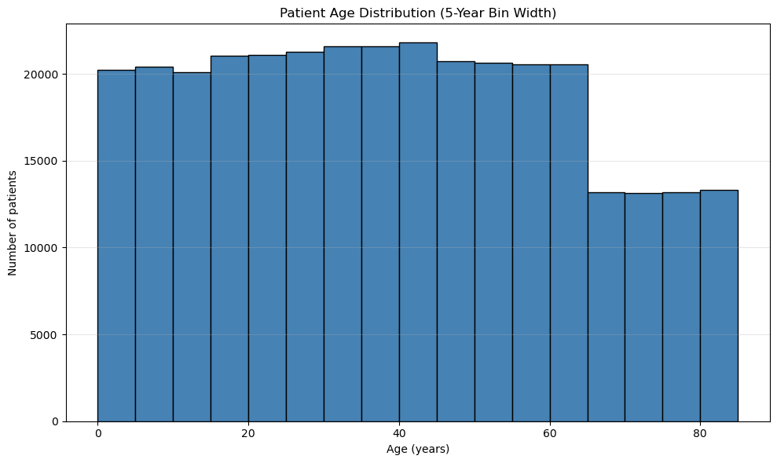
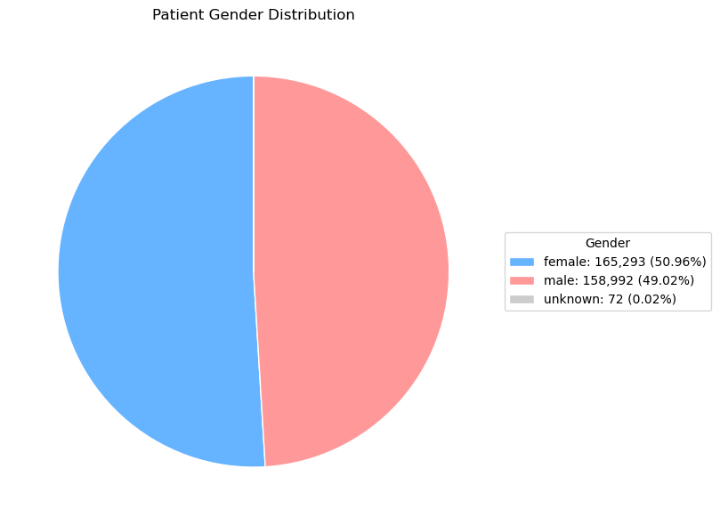

# Studio 2 — Data Structures and Analysis of Algorithms

[Back to course portfolio](../README.md)

**Author:** Liam Lian (xl758)  
**Course:** BIS/CBB 634, Fall 2026

## Code and progress

[Exercise 1 notebook](studio-02-xml.ipynb) contains the code and saved outputs for tasks 1a–1h. Exercise 1 is complete; Exercise 2 is not completed in this update.

To reproduce, download `patients.xml` from the authorized [Canvas data file](https://yale.instructure.com/courses/121398/files/13049637) and place it next to the notebook. The XML input remains local and is excluded from Git. In an environment with NumPy, pandas, matplotlib, and Jupyter installed, run from this folder:

```bash
jupyter notebook studio-02-xml.ipynb
```

Restart the kernel and run the cells in order. The current notebook uses an absolute local path in `file_path`; change that variable to the location of your downloaded XML before running on another machine.

## 1a — Parse XML and analyze age distribution

I parsed the XML with Python's standard-library `xml.etree.ElementTree`. The root is `patientdata`; `generated` and `institution` describe the file, while `patients` contains individual `patient` elements. Each patient stores `age`, `gender`, and `name` as attributes. Attribute order does not affect parsing.

I converted patient records to a pandas DataFrame and converted age text to numeric floating-point values without intentionally rounding them. Diagnoses are child elements and can occur more than once, so I preserved them as lists. Nested `testresults/weight` entries retain their numeric value, date, and units in lists of dictionaries. Empty lists mean that no corresponding entry was recorded, not that a patient has no disease or weighs zero.

### Histogram choice

After discussing different binning choices with classmates, we agreed that a **5-year bin width** provided the clearest view of the age distribution. I used this width for the histogram to balance detail and readability. The comparison was discussed in class; the notebook contains the selected histogram rather than a claim that several alternative plots were generated.



### Duplicate analysis and binary-search reflection

The dataset contains **324,357 patients**. Counting the parsed, unrounded age values produced:

```text
Any exact duplicate ages: False
Number of distinct ages shared by patients: 0
Total patients with a shared age: 0
```

This is an exact-equality check on the parsed numeric values, not a comparison of rounded ages or histogram groups. Decimal ages can still repeat; many decimal places alone do not establish uniqueness. The printed DataFrame precision only affects display.

No exact duplicate ages were found, so an exact-match binary search would return at most one patient for a given age in this dataset. If duplicate ages were present, stopping at any matching element would retrieve only one patient. To retrieve all matches, the implementation in 1e finds the first matching position with a left-boundary search and the position just after the last match with a right-boundary search, then takes the slice between them. Boundary searching takes O(log n); retrieving k matching records takes an additional O(k). The two boundary functions are implemented in task 1e.

## 1b — Gender distribution and encoding

Gender is a string attribute inside the opening `<patient>` tag, alongside age and name. The distinct categories found are:

| Gender | Patient count |
| --- | ---: |
| female | 165,293 |
| male | 158,992 |
| unknown | 72 |

I chose a pie chart to emphasize each category's share of the total. Female and male patients each make up close to half of the dataset. The `unknown` category accounts for approximately 0.02%, so its slice is very small; the legend includes both counts and percentages to keep it visible in the interpretation. I retained `unknown` as the recorded category.



## 1c — Age sorting and top-K retrieval

I converted the DataFrame into a list of patient dictionaries using `df.to_dict(orient="records")`, then sorted it in ascending age order using `sorted(..., key=lambda patient: patient["age"])`. The resulting `sorted_patients` list preserves each patient's fields. The final element, `sorted_patients[-1]`, is the oldest patient; the notebook also displays the five oldest records.

The oldest patient is **Monica Caponera**, age **84.99855742449432**, gender **female**. Sorting takes O(n log n) time in the general case; retrieving the final element afterward takes O(1).

## 1d — Single-pass second-oldest retrieval

I proposed scanning the original, unsorted patient list once while maintaining the oldest and second-oldest records. I store them in a two-element list: `top_two[0]` holds the oldest patient and `top_two[1]` holds the second oldest.

For each record, if its age exceeds the current maximum, I first move the previous oldest record into second place and then store the new oldest record. Otherwise, if its age exceeds the current second-oldest age, I replace only the second entry. The `None` initial values allow the first two records to populate the list, and the current code assumes at least two patients when interpreting both entries as records.

The algorithm uses **O(n) time and O(1) extra space**, beyond the existing patient list: it makes one pass and maintains only two record references. It does not use the sorted list from 1c to compute the result. Equal ages can occupy both positions when they belong to different patient records; this retrieves the second-oldest patient, not the second distinct age.

The second-oldest patient is **Raymond Leigh**, age **84.9982928781625**, gender **male**. Executing the notebook cells through 1d in order reproduced the documented counts, and the single-pass top two matched the two oldest records from the sorted list.

### Conceptual reflection

A single-pass approach is preferable when only the second-oldest patient is needed, because it avoids sorting the entire dataset. Sorting is more useful when repeated rank-based queries are required, such as retrieving the 10th- or 100th-oldest patient, or when every record needs an age rank. After an initial O(n log n) sort, each lookup by a known rank takes O(1) time. In the ascending list, the 10th-oldest patient is `sorted_patients[-10]`. Assigning an explicit rank to all records requires an additional O(n) pass; the current notebook does not add a rank field.

Looking up an individual by name to find their rank is a different operation and would require a separate index for fast queries. If equal ages existed, assigning numeric ranks would also require an explicit tie policy.

## 1e — Binary search for a target age

I use the ascending `sorted_patients` list from 1c rather than constructing a binary search tree. Two reusable functions, `binary_search_left(patients, target_age)` and `binary_search_right(patients, target_age)`, accept the sorted records and target age as arguments. Changing the target requires only a new argument, not rewriting the search logic.

Both functions maintain a half-open **index interval** `[left, right)`, initially covering all records from index `0` through `len(patients) - 1`. This index interval is distinct from the age-range conditions used in later queries. Each iteration checks the middle record and excludes roughly half the remaining interval. The loop stops when `left == right`.

- The left search moves `left` past `mid` when the middle age is less than the target; otherwise it sets `right = mid`. It returns the first position with age greater than or equal to the target.
- The right search moves `left` past `mid` when the middle age is less than or equal to the target; otherwise it sets `right = mid`. It returns the first position with age strictly greater than the target.

The slice `sorted_patients[left_index:right_index]` retrieves every exact match. With `target_age = 41.5`, execution gives left index **173886**, right index **173887**, and **1 matching patient: John Braswell, age 41.5**. Indices are zero-based.

### Reflection: missing targets and duplicate ages

When the target lies between existing ages, both functions return the same insertion position, so the slice is empty. Targets below the minimum or above the maximum also produce empty slices, at index 0 or n respectively. The code does not mistake the next older patient for an exact match.

If several records share the target age, the left search continues left on equality and the right search continues right on equality. Together, they enclose the entire matching block, rather than stopping at the first match encountered during the search. There are no duplicate ages in the supplied dataset, but the functions support them.

Each boundary search takes O(log n), and the searches run sequentially: O(log n) + O(log n) = O(log n), ignoring the constant factor of two. Computing the match count from `right_index - left_index` takes O(1) after those searches. The current implementation also copies the k matching records into a list slice, making full retrieval O(log n + k) time and O(k) output space. The searches themselves use O(1) extra space. These query costs assume the list has already been sorted in 1c.

### Validation

The seven notebook code cells through 1e ran in order. Separate checks of the same functions passed for duplicate matches, a target between existing ages, an empty list, a target above the maximum, and a target below the minimum. These checks validate 1e; they do not implement the later range-query tasks.

## 1f — Count patients at or above the target age

I reuse `left_index` from 1e, the first position whose age is greater than or equal to `target_age`. Because the list is sorted and indices start at zero, `left_index` equals the number of patients younger than the target. Subtracting this index from the total list length counts all remaining patients, including exact matches:

```python
count_at_least_target = len(sorted_patients) - left_index

print(f"Patients aged at least {target_age}: {count_at_least_target}")
```

For a target age of **41.5**, the total is **324,357** and the left boundary is **173,886**, giving **150,471 patients aged at least 41.5**. The saved output is:

```text
Patients aged at least 41.5: 150471
```

This calculation takes **O(1)** time and extra space once the boundary is available: Python list length and integer subtraction do not require traversal or slicing. Finding the left boundary initially takes O(log n) on the already sorted list. Task 1f does not need the right boundary or the matching-record slice used in 1e. If the target changes, the left boundary must first be recomputed for that target.

The same formula handles a target below all ages (`left_index = 0`, count = n), above all ages (`left_index = n`, count = 0), or absent between existing ages. If the target age is duplicated, the left boundary includes every matching patient in the count.

Validation: the notebook code through 1f executed in order, and an independent full scan confirmed the count of 150,471. The full scan was a verification step, not part of the O(1) calculation.

## 1g — Age range queries

`count_patients_in_range(patients, low_age, high_age)` reuses the left-boundary function from 1e on the ascending patient list. It returns the number of records satisfying **low_age <= age < high_age**. It returns zero immediately when `low_age >= high_age`.

For a nonempty interval, the first search finds the first age greater than or equal to `low_age`. The second finds the first age greater than or equal to `high_age`. The difference `high_index - low_index` therefore includes the lower endpoint and excludes the upper endpoint, including when either endpoint has duplicate ages. No matching-record slice is created.

The notebook query `[40, 50)` prints:

```text
Patients aged 40 to under 50: 42525
```

Each binary search halves the remaining interval at every iteration and uses O(log n) time. Two sequential searches plus one subtraction still take **O(log n)** time, with **O(1)** extra space. These costs assume the age sorting from 1c is already complete; no sorting or full scan occurs inside this function. Equal or reversed bounds return in O(1).

### Validation

The nine notebook code cells through 1g executed in order. An independent full scan confirmed the real-data count of **42,525** for `[40, 50)`. The following separate test cases also passed using the notebook's function. Synthetic sorted ages make endpoint inclusion and duplicates explicit; these checks are validation, not extra steps in the query algorithm.

| Case | Sorted ages | Query interval | Expected and observed count |
| --- | --- | --- | ---: |
| Exact endpoints and duplicates | `[40, 40, 45, 50, 50]` | `[40, 50)` | 3 |
| Between existing ages | `[40, 45, 50]` | `[41, 49)` | 1 |
| Bounds beyond data | `[40, 45, 50]` | `[0, 100)` | 3 |
| Entirely below data | `[40, 45, 50]` | `[0, 30)` | 0 |
| Entirely above data | `[40, 45, 50]` | `[60, 70)` | 0 |
| Equal bounds | `[40, 45, 50]` | `[45, 45)` | 0 |
| Reversed bounds | `[40, 45, 50]` | `[50, 40)` | 0 |
| Empty input | `[]` | `[40, 50)` | 0 |

## 1h — Age and gender range queries

I build `male_sorted_patients` once by filtering the already sorted list for records whose `gender` attribute equals `"male"`. Filtering preserves the age order, so no second sort is necessary. This creates a secondary age index containing references to the male patient records.

`count_patients_by_age_and_gender(sorted_patients, male_sorted_patients, low_age, high_age)` calls the 1g function on each list and returns `(total_count, male_count)`. Both counts use the interval `low_age <= age < high_age`. The total includes all recorded gender categories, including `unknown`; the male count includes only `male`.

The saved example output is:

```text
Age range: [40, 50)
Total patients: 42525
Male patients: 20873
```

### Setup and query complexity

The original age sort in 1c costs O(n log n). Building the male index afterward costs **O(n) time and O(m) extra space**, where m = 158,992 is the number of male patients. The new list contains record references rather than deep copies.

Each query performs two boundary searches on the full list and two on the male list. Its cost is **O(log n + log m)**, hence **O(log n)** because m <= n, with O(1) extra query space. An empty male index returns zero immediately through the same range-count logic. Filtering is outside the query function and is not repeated per query. Both sorted lists must be rebuilt or maintained if the underlying ages or gender records change.

### Validation

All ten notebook code cells executed in order. For the full dataset, the returned pair was checked against independent full scans for `[40, 50)`, `[41.5, 50)`, `[0, 100)`, `[-10, 0)`, `[100, 110)`, `[50, 50)`, and reversed bounds `[50, 40)`. All seven checks passed. The scans were validation only, not part of the query implementation.

Additional synthetic checks passed:

| Case | Sorted (age, gender) records | Interval | Expected and observed (total, male) |
| --- | --- | --- | --- |
| Duplicate endpoints | (40, male), (40, female), (45, unknown), (50, male) | `[40, 50)` | (3, 1) |
| No male records | (40, female), (45, unknown) | `[40, 50)` | (2, 0) |
| Empty input | No records | `[40, 50)` | (0, 0) |

## Exercise 1 completion

Tasks 1a–1h are implemented in the notebook and documented here: XML parsing, age and gender visualizations, duplicate analysis, age sorting, single-pass top-two retrieval, exact-age searches, threshold counting, age-range counting, and age-plus-gender counting. The functions assume age-sorted inputs and valid numeric query bounds. The saved figures and outputs support the documented findings. This completion status covers Exercise 1 code and documentation; it does not imply that Exercise 2 or a Canvas submission has been completed.

## Code evolution and design choices

I inspected the XML structure and expanded the initial attribute-only parsing to preserve diagnoses and nested weight records. I selected 5-year age bins after classroom discussion, chose the gender pie chart, and proposed both the single-pass top-two algorithm and the use of a two-element list. I identified repeated ranking queries and explicit per-record ranks as reasons to prefer upfront sorting.

For task 1g, I initially considered using a left-boundary search for the lower limit and a right-boundary search for the upper limit. I then recognized that the required interval is `low_age <= age < high_age`, so both limits need a left-boundary search. Using a right-boundary search for the upper limit would include patients exactly at `high_age`, which would instead implement `low_age <= age <= high_age`. This helped me connect the choice of boundary function to whether each endpoint is included. I reused the functions from 1e rather than writing a separate search algorithm.

For 1h, I proposed filtering the sorted patient list once to create a male-only sorted list and then reusing the 1g function. I also considered changing 1g to return a DataFrame of all matching records and counting genders afterward. That would be convenient for inspecting records, but materializing and scanning k matches adds O(k) work, making a query O(log n + k) instead of the required O(log n). I therefore kept the count-only function and the precomputed male index. This separates the one-time O(n) filtering cost from repeated logarithmic-time queries.

## AI assistance

I used OpenAI Codex to help implement these choices, explain binary-search boundaries and complexity, and write this README. I retained responsibility for the substantive decisions and interpretations. The notebook outputs record the work completed so far; Exercise 1 tasks 1a–1h are implemented; Exercise 2 is not presented as completed.
