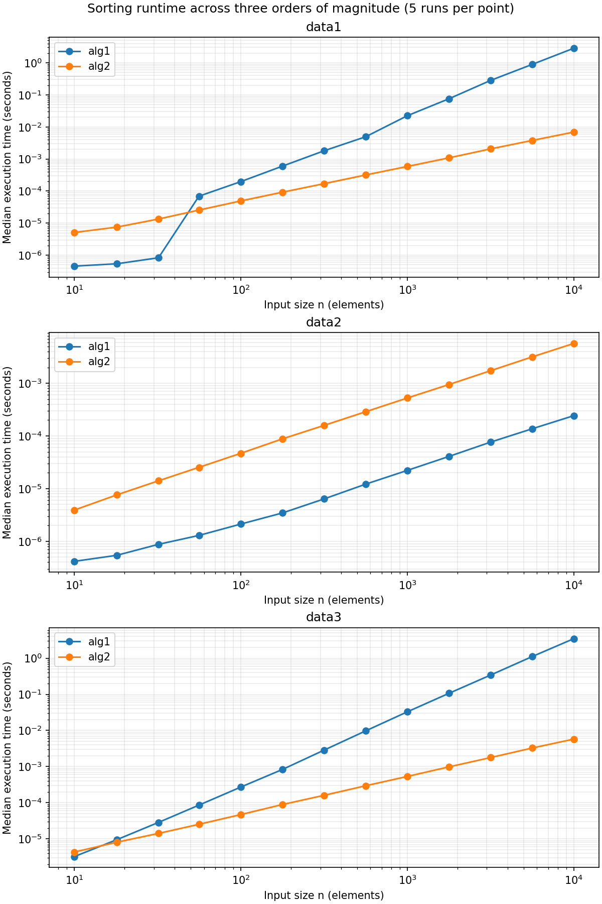

# Studio 2 — Data Structures and Analysis of Algorithms

[Back to course portfolio](../README.md)

**Author:** Liam Lian (xl758)  
**Course:** BIS/CBB 634, Fall 2026

## Code and progress

[Exercise 1 notebook](studio-02-xml.ipynb) contains the code and saved outputs for tasks 1a–1h. Exercise 1 is complete.

To reproduce, download `patients.xml` from the authorized [Canvas data file](https://yale.instructure.com/courses/121398/files/13049637) and place it next to the notebook. The XML input remains local and is excluded from Git. In an environment with NumPy, pandas, matplotlib, and Jupyter installed, run from this folder:

```bash
jupyter notebook studio-02-xml.ipynb
```

Restart the kernel and run the cells in order. The current notebook uses an absolute local path in `file_path`; change that variable to the location of your downloaded XML before running on another machine.

## Reproducible validation

[validation.py](validation.py) is a standalone script containing verbatim copies of the four search and counting functions from the exercise, followed by explicit synthetic test inputs. It does not read the notebook or patient XML and needs only Python's standard library.

```bash
python validation.py
python validation.py > validation-output.txt
```

For each case it prints the input, target or interval, expected result, actual result, and pass/fail status. It reproduces all eight rows of the 1g validation table and all three synthetic cases in 1h, plus five 1e boundary cases and one 1f threshold case. The [saved output](validation-output.txt) records **17 passing cases**. A mismatch raises an error. Copies of the functions should be updated when the notebook algorithms change.

The synthetic script checks algorithm behavior on small, visible examples. The real-data checks described below were performed separately during development; this script does not rerun them. Complexity is justified analytically, not inferred from these tests.

## 1a — Parse XML and analyze age distribution

I parsed the XML with Python's standard-library `xml.etree.ElementTree`. The root is `patientdata`; `generated` and `institution` describe the file, while `patients` contains individual `patient` elements. Each patient stores `age`, `gender`, and `name` as attributes. Attribute order does not affect parsing.

I converted patient records to a pandas DataFrame and converted age text to numeric floating-point values without intentionally rounding them. Diagnoses are child elements and can occur more than once, so I preserved them as lists. Nested `testresults/weight` entries retain their numeric value, date, and units in lists of dictionaries. Empty lists mean that no corresponding entry was recorded, not that a patient has no disease or weighs zero.

### Histogram choice

After discussing different binning choices with classmates, we agreed that a **5-year bin width** provided the clearest view of the age distribution. I used this width for the histogram to balance detail and readability. The comparison was discussed in class; the notebook contains the selected histogram rather than a claim that several alternative plots were generated.


### Duplicate analysis and binary-search reflection

The dataset contains **324,357 patients**. Counting the parsed, unrounded age values produced:

```text
Any exact duplicate ages: False
Number of distinct ages shared by patients: 0
Total patients with a shared age: 0
```

This is an exact-equality check on the parsed numeric values, not a comparison of rounded ages or histogram groups. Decimal ages can still repeat; many decimal places alone do not establish uniqueness. The printed DataFrame precision only affects display.

No exact duplicate ages were found, so an exact-match binary search would return at most one patient for a given age in this dataset. If duplicate ages were present, stopping at any matching element would retrieve only one patient. To retrieve all matches, the implementation in 1e finds the first matching position with a left-boundary search and the position just after the last match with a right-boundary search, then takes the slice between them. Boundary searching takes O(log n); retrieving k matching records takes an additional O(k). The two boundary functions are implemented in task 1e.

## 1b — Gender distribution and encoding

Gender is a string attribute inside the opening `<patient>` tag, alongside age and name. The distinct categories found are:

| Gender | Patient count |
| --- | ---: |
| female | 165,293 |
| male | 158,992 |
| unknown | 72 |

I chose a pie chart to emphasize each category's share of the total. Female and male patients each make up close to half of the dataset. The `unknown` category accounts for approximately 0.02%, so its slice is very small; the legend includes both counts and percentages to keep it visible in the interpretation. I retained `unknown` as the recorded category.


## 1c — Age sorting and top-K retrieval

```python
# Convert the DataFrame into a list of patient records
patients = df.to_dict(orient="records")

# Sort records by age in ascending order
sorted_patients = sorted(patients, key=lambda patient: patient["age"])

# The last record contains the oldest patient
oldest_patient = sorted_patients[-1]

print("Oldest patient:")
print("Name:", oldest_patient["name"])
print("Age:", oldest_patient["age"])
print("Gender:", oldest_patient["gender"])

display(pd.DataFrame(sorted_patients[-5:]))
```

I converted the DataFrame into a list of patient dictionaries using `df.to_dict(orient="records")`, then sorted it in ascending age order using `sorted(..., key=lambda patient: patient["age"])`. The resulting `sorted_patients` list preserves each patient's fields. The final element, `sorted_patients[-1]`, is the oldest patient; the notebook also displays the five oldest records.

The oldest patient is **Monica Caponera**, age **84.99855742449432**, gender **female**. Sorting takes O(n log n) time in the general case; retrieving the final element afterward takes O(1).

## 1d — Single-pass second-oldest retrieval

```python
top_two = [None, None]

for i in range(len(patients)):
    current = patients[i]

    if top_two[0] is None or current["age"] > top_two[0]["age"]:
        top_two[1] = top_two[0]
        top_two[0] = current
    elif top_two[1] is None or current["age"] > top_two[1]["age"]:
        top_two[1] = current

display(pd.DataFrame(top_two, index=["Oldest", "Second oldest"]))
```

I proposed scanning the original, unsorted patient list once while maintaining the oldest and second-oldest records. I store them in a two-element list: `top_two[0]` holds the oldest patient and `top_two[1]` holds the second oldest.

For each record, if its age exceeds the current maximum, I first move the previous oldest record into second place and then store the new oldest record. Otherwise, if its age exceeds the current second-oldest age, I replace only the second entry. The `None` initial values allow the first two records to populate the list, and the current code assumes at least two patients when interpreting both entries as records.

The algorithm uses **O(n) time and O(1) extra space**, beyond the existing patient list: it makes one pass and maintains only two record references. It does not use the sorted list from 1c to compute the result. Equal ages can occupy both positions when they belong to different patient records; this retrieves the second-oldest patient, not the second distinct age.

The second-oldest patient is **Raymond Leigh**, age **84.9982928781625**, gender **male**. Executing the notebook cells through 1d in order reproduced the documented counts, and the single-pass top two matched the two oldest records from the sorted list.

### Conceptual reflection

A single-pass approach is preferable when only the second-oldest patient is needed, because it avoids sorting the entire dataset. Sorting is more useful when repeated rank-based queries are required, such as retrieving the 10th- or 100th-oldest patient, or when every record needs an age rank. After an initial O(n log n) sort, each lookup by a known rank takes O(1) time. In the ascending list, the 10th-oldest patient is `sorted_patients[-10]`. Assigning an explicit rank to all records requires an additional O(n) pass; the current notebook does not add a rank field.

Looking up an individual by name to find their rank is a different operation and would require a separate index for fast queries. If equal ages existed, assigning numeric ranks would also require an explicit tie policy.

## 1e — Binary search for a target age

```python
def binary_search_left(patients, target_age):
    left = 0
    right = len(patients)

    while left < right:
        mid = (left + right) // 2

        if patients[mid]["age"] < target_age:
            left = mid + 1
        else:
            right = mid

    return left

def binary_search_right(patients, target_age):
    left = 0
    right = len(patients)

    while left < right:
        mid = (left + right) // 2

        if patients[mid]["age"] <= target_age:
            left = mid + 1
        else:
            right = mid

    return left

target_age = 41.5

left_index = binary_search_left(sorted_patients, target_age)
right_index = binary_search_right(sorted_patients, target_age)

matching_patients = sorted_patients[left_index:right_index]

print("Matching patients:", len(matching_patients))
display(pd.DataFrame(matching_patients))
```

I use the ascending `sorted_patients` list from 1c rather than constructing a binary search tree. Two reusable functions, `binary_search_left(patients, target_age)` and `binary_search_right(patients, target_age)`, accept the sorted records and target age as arguments. Changing the target requires only a new argument, not rewriting the search logic.

Both functions maintain a half-open **index interval** `[left, right)`, initially covering all records from index `0` through `len(patients) - 1`. This index interval is distinct from the age-range conditions used in later queries. Each iteration checks the middle record and excludes roughly half the remaining interval. The loop stops when `left == right`.

- The left search moves `left` past `mid` when the middle age is less than the target; otherwise it sets `right = mid`. It returns the first position with age greater than or equal to the target.
- The right search moves `left` past `mid` when the middle age is less than or equal to the target; otherwise it sets `right = mid`. It returns the first position with age strictly greater than the target.

The slice `sorted_patients[left_index:right_index]` retrieves every exact match. With `target_age = 41.5`, execution gives left index **173886**, right index **173887**, and **1 matching patient: John Braswell, age 41.5**. Indices are zero-based.

### Reflection: missing targets and duplicate ages

When the target lies between existing ages, both functions return the same insertion position, so the slice is empty. Targets below the minimum or above the maximum also produce empty slices, at index 0 or n respectively. The code does not mistake the next older patient for an exact match.

If several records share the target age, the left search continues left on equality and the right search continues right on equality. Together, they enclose the entire matching block, rather than stopping at the first match encountered during the search. There are no duplicate ages in the supplied dataset, but the functions support them.

Each boundary search takes O(log n), and the searches run sequentially: O(log n) + O(log n) = O(log n), ignoring the constant factor of two. Computing the match count from `right_index - left_index` takes O(1) after those searches. The current implementation also copies the k matching records into a list slice, making full retrieval O(log n + k) time and O(k) output space. The searches themselves use O(1) extra space. These query costs assume the list has already been sorted in 1c.

### Validation

Reproduce the synthetic cases with [validation.py](validation.py); see the [actual run output](validation-output.txt). Real-data execution checks described here were performed separately during development.

The seven notebook code cells through 1e ran in order. Separate checks of the same functions passed for duplicate matches, a target between existing ages, an empty list, a target above the maximum, and a target below the minimum. These checks validate 1e; they do not implement the later range-query tasks.

## 1f — Count patients at or above the target age

I reuse `left_index` from 1e, the first position whose age is greater than or equal to `target_age`. Because the list is sorted and indices start at zero, `left_index` equals the number of patients younger than the target. Subtracting this index from the total list length counts all remaining patients, including exact matches:

```python
count_at_least_target = len(sorted_patients) - left_index

print(f"Patients aged at least {target_age}: {count_at_least_target}")
```

For a target age of **41.5**, the total is **324,357** and the left boundary is **173,886**, giving **150,471 patients aged at least 41.5**. The saved output is:

```text
Patients aged at least 41.5: 150471
```

This calculation takes **O(1)** time and extra space once the boundary is available: Python list length and integer subtraction do not require traversal or slicing. Finding the left boundary initially takes O(log n) on the already sorted list. Task 1f does not need the right boundary or the matching-record slice used in 1e. If the target changes, the left boundary must first be recomputed for that target.

The same formula handles a target below all ages (`left_index = 0`, count = n), above all ages (`left_index = n`, count = 0), or absent between existing ages. If the target age is duplicated, the left boundary includes every matching patient in the count.

Validation: the notebook code through 1f executed in order, and an independent full scan confirmed the count of 150,471. The full scan was a verification step, not part of the O(1) calculation.

## 1g — Age range queries

```python
def count_patients_in_range(patients, low_age, high_age):
    if low_age >= high_age:
        return 0

    low_index = binary_search_left(patients, low_age)
    high_index = binary_search_left(patients, high_age)

    return high_index - low_index


count = count_patients_in_range(sorted_patients, 40, 50)
print("Patients aged 40 to under 50:", count)
```

`count_patients_in_range(patients, low_age, high_age)` reuses the left-boundary function from 1e on the ascending patient list. It returns the number of records satisfying **low_age <= age < high_age**. It returns zero immediately when `low_age >= high_age`.

For a nonempty interval, the first search finds the first age greater than or equal to `low_age`. The second finds the first age greater than or equal to `high_age`. The difference `high_index - low_index` therefore includes the lower endpoint and excludes the upper endpoint, including when either endpoint has duplicate ages. No matching-record slice is created.

The notebook query `[40, 50)` prints:

```text
Patients aged 40 to under 50: 42525
```

Each binary search halves the remaining interval at every iteration and uses O(log n) time. Two sequential searches plus one subtraction still take **O(log n)** time, with **O(1)** extra space. These costs assume the age sorting from 1c is already complete; no sorting or full scan occurs inside this function. Equal or reversed bounds return in O(1).

### Validation

Reproduce the synthetic cases with [validation.py](validation.py); see the [actual run output](validation-output.txt). Real-data execution checks described here were performed separately during development.

The nine notebook code cells through 1g executed in order. An independent full scan confirmed the real-data count of **42,525** for `[40, 50)`. The following separate test cases also passed using the notebook's function. Synthetic sorted ages make endpoint inclusion and duplicates explicit; these checks are validation, not extra steps in the query algorithm.

| Case | Sorted ages | Query interval | Expected and observed count |
| --- | --- | --- | ---: |
| Exact endpoints and duplicates | `[40, 40, 45, 50, 50]` | `[40, 50)` | 3 |
| Between existing ages | `[40, 45, 50]` | `[41, 49)` | 1 |
| Bounds beyond data | `[40, 45, 50]` | `[0, 100)` | 3 |
| Entirely below data | `[40, 45, 50]` | `[0, 30)` | 0 |
| Entirely above data | `[40, 45, 50]` | `[60, 70)` | 0 |
| Equal bounds | `[40, 45, 50]` | `[45, 45)` | 0 |
| Reversed bounds | `[40, 45, 50]` | `[50, 40)` | 0 |
| Empty input | `[]` | `[40, 50)` | 0 |

## 1h — Age and gender range queries

```python
male_sorted_patients = [
    patient
    for patient in sorted_patients
    if patient["gender"] == "male"
]

def count_patients_by_age_and_gender(
    sorted_patients, male_sorted_patients, low_age, high_age
):
    total_count = count_patients_in_range(
        sorted_patients, low_age, high_age
    )
    male_count = count_patients_in_range(
        male_sorted_patients, low_age, high_age
    )

    return total_count, male_count

low_age = 40
high_age = 50

total_count, male_count = count_patients_by_age_and_gender(
    sorted_patients,
    male_sorted_patients,
    low_age,
    high_age
)

print(f"Age range: [{low_age}, {high_age})")
print("Total patients:", total_count)
print("Male patients:", male_count)
```

I build `male_sorted_patients` once by filtering the already sorted list for records whose `gender` attribute equals `"male"`. Filtering preserves the age order, so no second sort is necessary. This creates a secondary age index containing references to the male patient records.

`count_patients_by_age_and_gender(sorted_patients, male_sorted_patients, low_age, high_age)` calls the 1g function on each list and returns `(total_count, male_count)`. Both counts use the interval `low_age <= age < high_age`. The total includes all recorded gender categories, including `unknown`; the male count includes only `male`.

The saved example output is:

```text
Age range: [40, 50)
Total patients: 42525
Male patients: 20873
```

### Setup and query complexity

The original age sort in 1c costs O(n log n). Building the male index afterward costs **O(n) time and O(m) extra space**, where m = 158,992 is the number of male patients. The new list contains record references rather than deep copies.

Each query performs two boundary searches on the full list and two on the male list. Its cost is **O(log n + log m)**, hence **O(log n)** because m <= n, with O(1) extra query space. An empty male index returns zero immediately through the same range-count logic. Filtering is outside the query function and is not repeated per query. Both sorted lists must be rebuilt or maintained if the underlying ages or gender records change.

### Validation

Reproduce the synthetic cases with [validation.py](validation.py); see the [actual run output](validation-output.txt). Real-data execution checks described here were performed separately during development.

All ten notebook code cells executed in order. For the full dataset, the returned pair was checked against independent full scans for `[40, 50)`, `[41.5, 50)`, `[0, 100)`, `[-10, 0)`, `[100, 110)`, `[50, 50)`, and reversed bounds `[50, 40)`. All seven checks passed. The scans were validation only, not part of the query implementation.

Additional synthetic checks passed:

| Case | Sorted (age, gender) records | Interval | Expected and observed (total, male) |
| --- | --- | --- | --- |
| Duplicate endpoints | (40, male), (40, female), (45, unknown), (50, male) | `[40, 50)` | (3, 1) |
| No male records | (40, female), (45, unknown) | `[40, 50)` | (2, 0) |
| Empty input | No records | `[40, 50)` | (0, 0) |

## Code evolution and design choices

I inspected the XML structure and expanded the initial attribute-only parsing to preserve diagnoses and nested weight records. I selected 5-year age bins after classroom discussion, chose the gender pie chart, and proposed both the single-pass top-two algorithm and the use of a two-element list. I identified repeated ranking queries and explicit per-record ranks as reasons to prefer upfront sorting.

For task 1g, I initially considered using a left-boundary search for the lower limit and a right-boundary search for the upper limit. I then recognized that the required interval is `low_age <= age < high_age`, so both limits need a left-boundary search. Using a right-boundary search for the upper limit would include patients exactly at `high_age`, which would instead implement `low_age <= age <= high_age`. This helped me connect the choice of boundary function to whether each endpoint is included. I reused the functions from 1e rather than writing a separate search algorithm.

For 1h, I proposed filtering the sorted patient list once to create a male-only sorted list and then reusing the 1g function. I also considered changing 1g to return a DataFrame of all matching records and counting genders afterward. That would be convenient for inspecting records, but materializing and scanning k matches adds O(k) work, making a query O(log n + k) instead of the required O(log n). I therefore kept the count-only function and the precomputed male index. This separates the one-time O(n) filtering cost from repeated logarithmic-time queries.

## AI assistance

I used OpenAI Codex to help implement these choices, explain binary-search boundaries and complexity, and write this README. I retained responsibility for the substantive decisions and interpretations.

## Exercise 2 — Algorithm Analysis and Performance Measurement

### Code and reproduction

[Exercise 2 notebook](studio-02-algorithm-analysis.ipynb) contains the supplied algorithms, data generators, the 2a output analysis, and the 2b benchmark. With NumPy and Jupyter installed, open the notebook, restart the kernel, and run all cells in order. No patient dataset is required.

### 2a — Output analysis

I used all three provided generators with `n = 8`. Each algorithm receives a copy of the same input, and I compare both outputs with Python's `sorted()` result. These are small functionality checks, not performance measurements.

```python
n = 8

test_cases = [
    ("data1", data1(n)),
    ("data2", data2(n)),
    ("data3", data3(n)),
]

for case_name, test_input in test_cases:
    output1 = alg1(test_input.copy())
    output2 = alg2(test_input.copy())
    expected = sorted(test_input)

    print(f"Case: {case_name}")
    print("Input:   ", test_input)
    print("alg1:    ", output1)
    print("alg2:    ", output2)
    print("Both correct:", output1 == expected and output2 == expected)
    print("-" * 50)
```

#### Actual inputs and outputs

```text
Case: data1
Input:    [31.0, 31.026, 31.07515666666667, 31.1456131764, 31.236317170692352, 31.346883543428103, 31.477492347868477, 31.628814213217787]
alg1:     [31.0, 31.026, 31.07515666666667, 31.1456131764, 31.236317170692352, 31.346883543428103, 31.477492347868477, 31.628814213217787]
alg2:     [31.0, 31.026, 31.07515666666667, 31.1456131764, 31.236317170692352, 31.346883543428103, 31.477492347868477, 31.628814213217787]
Both correct: True
--------------------------------------------------
Case: data2
Input:    [0, 1, 2, 3, 4, 5, 6, 7]
alg1:     [0, 1, 2, 3, 4, 5, 6, 7]
alg2:     [0, 1, 2, 3, 4, 5, 6, 7]
Both correct: True
--------------------------------------------------
Case: data3
Input:    [8, 7, 6, 5, 4, 3, 2, 1]
alg1:     [1, 2, 3, 4, 5, 6, 7, 8]
alg2:     [1, 2, 3, 4, 5, 6, 7, 8]
Both correct: True
--------------------------------------------------
```

Both functions return ascending sequences for all three inputs. The first eight default `data1` values happen to be increasing, so their order remains unchanged; this short sample does not establish that longer outputs are always sorted. `data2` is already ascending. `data3` is descending and is reversed into ascending order by both algorithms. All three comparisons with `sorted()` return `True`.

#### Conceptual mechanics

**alg1:** The function repeatedly scans adjacent pairs and swaps them when the right value is smaller than the left. A large value can move right through successive swaps during one scan. If any swap occurs, `changes` becomes `True` and another scan follows. A complete scan with no swaps establishes that the list is ordered and ends the loop. This is bubble sort with an early-exit check. Already ordered input needs one scan, O(n); reverse-ordered input needs O(n) scans of O(n) comparisons, giving O(n²).

**alg2:** The function recursively divides the list into two parts until each part contains at most one element. Those parts are already sorted. It then merges sorted halves by comparing their current first remaining elements, appending the smaller one, and advancing that side's iterator. `alg2(...)` performs the sorting; `iter(...)` only allows sequential access to the sorted result. When `next()` raises `StopIteration`, that side is exhausted, so the function returns the accumulated result plus the other side's current element and remaining iterator values. The current element must be included separately because it has already been removed from the iterator. This is merge sort.

For n = 4, the recursion has 1 + 2 + 4 = 7 calls, but a call's cost depends on the size of its list. Combining two sorted halves of total length m takes O(m) work. Each merge level processes O(n) elements in total, and there are O(log n) levels, giving O(n log n). List slicing also costs O(n) per level in total and does not change this order. Execution processes the left subtree, then the right subtree, before merging; it does not execute all tree nodes simultaneously.

### 2b — Benchmarking and log-log scaling

#### Method

I benchmarked both algorithms on `data1`, `data2`, and `data3` at eight logarithmically spaced input sizes: **100, 153, 235, 360, 553, 848, 1301, and 1995**. For each input, I warmed up both algorithms, measured five runs with `time.perf_counter()`, and reported the median. The execution order alternates between repeats to reduce order effects.

Data generation, the external input copy, the reference `sorted()` result, and correctness checks are outside the timed block. The timed call includes the algorithm's own work, including copying inside `alg1` and slicing inside `alg2`. Both algorithms receive the same values for a given generator and n.

#### Benchmark code

```python
import time
import numpy as np
import pandas as pd
import matplotlib.pyplot as plt

# Start with moderate sizes because alg1 can be slow.
sizes = np.unique(np.logspace(2, 3.3, num=8).astype(int))
repeats = 5

generators = {
    "data1": data1,
    "data2": data2,
    "data3": data3,
}

algorithms = {
    "alg1": alg1,
    "alg2": alg2,
}

records = []

for data_name, generator in generators.items():
    for n in sizes:
        # Generate the same input for both algorithms outside timing.
        test_data = generator(int(n))
        expected = sorted(test_data)

        timings = {name: [] for name in algorithms}

        # Warm up each algorithm outside timing.
        for algorithm in algorithms.values():
            assert algorithm(test_data.copy()) == expected

        for repeat in range(repeats):
            # Alternate execution order to reduce order effects.
            order = list(algorithms.items())
            if repeat % 2 == 1:
                order.reverse()

            for algorithm_name, algorithm in order:
                input_copy = test_data.copy()

                start = time.perf_counter()
                result = algorithm(input_copy)
                elapsed = time.perf_counter() - start

                # Check correctness outside timing.
                assert result == expected

                timings[algorithm_name].append(elapsed)

        for algorithm_name, measured_times in timings.items():
            records.append({
                "dataset": data_name,
                "n": int(n),
                "algorithm": algorithm_name,
                "median_seconds": float(np.median(measured_times)),
            })

results = pd.DataFrame(records)

display(
    results.pivot(
        index=["dataset", "n"],
        columns="algorithm",
        values="median_seconds",
    )
)

# Plot one panel for each data generator.
fig, axes = plt.subplots(1, 3, figsize=(16, 5))

for ax, data_name in zip(axes, generators):
    for algorithm_name in algorithms:
        subset = results[
            (results["dataset"] == data_name)
            & (results["algorithm"] == algorithm_name)
        ].sort_values("n")

        ax.loglog(
            subset["n"],
            subset["median_seconds"],
            marker="o",
            label=algorithm_name,
        )

    ax.set_title(data_name)
    ax.set_xlabel("Input size (n)")
    ax.set_ylabel("Median execution time (seconds)")
    ax.grid(True, which="both", alpha=0.3)
    ax.legend()

fig.suptitle("Algorithm Runtime Comparison")
plt.tight_layout()
plt.show()

# Estimate the slope over the measured range.
slope_records = []

for data_name in generators:
    for algorithm_name in algorithms:
        subset = results[
            (results["dataset"] == data_name)
            & (results["algorithm"] == algorithm_name)
        ].sort_values("n")

        slope, intercept = np.polyfit(
            np.log10(subset["n"]),
            np.log10(subset["median_seconds"]),
            deg=1,
        )

        slope_records.append({
            "dataset": data_name,
            "algorithm": algorithm_name,
            "estimated_slope": slope,
        })

slopes = pd.DataFrame(slope_records)
display(slopes)
```

#### Saved results



The [saved timing and slope tables](benchmark-results.txt) are extracted from the notebook's original saved run. Timings will vary between runs and machines.

| Dataset | alg1 estimated slope | alg2 estimated slope |
| --- | ---: | ---: |
| data1 | 2.079412 | 1.062627 |
| data2 | 1.013919 | 1.050273 |
| data3 | 2.069037 | 1.041350 |

#### Interpreting the log-log plot

Both axes use logarithmic scales: equal distances correspond to equal ratios, not equal absolute increases. A straight line on these axes suggests a power-law relationship over the measured range, not exponential growth. If T(n) = C n^p, then log T(n) = log C + p log n, so the slope estimates p. A slope near 1 means that a tenfold increase in n corresponds to roughly tenfold time; a slope near 2 means roughly a hundredfold time.

At the same n, a lower curve indicates faster execution; a steeper curve indicates faster growth in time as n increases. The three panels use different vertical ranges, so cross-panel comparisons require reading the tick values.

For data1 and data3, alg1's slopes are near 2, consistent with its repeated-scan quadratic behavior. For already sorted data2, its slope is near 1, consistent with exiting after one scan. alg2's slopes are near 1 in this finite experiment. They do not establish O(n) complexity: its divide-and-merge structure remains O(n log n), and the logarithmic factor grows slowly. Runtime overhead, input sizes, and implementation details affect fitted slopes. These empirical results support interpretation alongside the code; fitted slopes alone do not prove Big-O bounds.

### 2c — Evaluation and data-dependent behavior

#### Why neither algorithm is always faster

The measured performance depends on the input order and the work each algorithm performs. For already sorted `data2`, alg1 finishes after one scan with no swaps. This is O(n), consistent with the fitted slope of 1.013919, and it is faster than alg2 in this experiment.

For `data1` and reverse-sorted `data3`, alg1 requires repeated scans and swaps. Their fitted slopes, 2.079412 and 2.069037, are close to quadratic growth. As n increases, the performance gap in favor of alg2 becomes larger. The irregular ordering in data1 affects how many passes are needed; descending data3 requires many passes because small elements can move left only one position per pass in this implementation.

alg2 divides and merges the input regardless of whether it is initially sorted. Its O(n log n) structure is relatively insensitive to input order, although the precise comparison counts and measured times can still vary. It does not exploit already sorted input by stopping after a single scan, which explains why alg1 wins on data2. These observations connect the empirical plots to the underlying mechanics rather than assuming that one algorithm must always be faster.

#### My choice for real-world inputs

Between these two algorithms, I would choose **alg2** when the input order is unknown or varies. Its performance is less sensitive to input order, making runtime growth more predictable as the dataset increases in size. This means a more predictable scaling trend, not identical elapsed times on every run.

If the input is known to be already sorted, alg1 can be preferable because its early-exit condition terminates after one scan, as demonstrated by data2. My preference for alg2 applies to general inputs with uncertain ordering, not to every possible data condition.

### Exercise 2 — Code evolution and design choices

I traced alg1's swap flag and recognized that any swap triggers another full scan, leading to quadratic worst-case behavior. For alg2, I worked through splitting, recursion, iterator advancement, and exhaustion handling. I drew the decomposition of `[4, 1, 3, 2]`, followed by merging into `[1, 4]`, `[2, 3]`, and finally `[1, 2, 3, 4]`. I distinguished the geometric growth in function-call counts from the work performed per call, which explains the O(n log n) total.

For output analysis, I chose small inputs from the supplied generators to connect the functionality checks with the later benchmarking tasks. The generator definitions were added to the saved notebook so it can run after a kernel restart without relying on previous session state.

I initially interpreted the log-log plot as potentially indicating exponential growth. I then distinguished the logarithmic axis scale from the runtime relationship: the slope estimates a power exponent over the tested range. I connected the near-2 slopes of alg1 on data1 and data3, and its near-1 slope on sorted data2, with the number of scans required.

For 2c, I connected the different execution times to input order and chose alg2 for inputs with unknown or changing order because its runtime growth is more predictable. I retained the already-sorted case as an exception where alg1 benefits from its early exit.

### Exercise 2 — Validation and AI assistance

The algorithm definitions, restored generator definitions, and 2a test cell executed in order in a fresh Python namespace. Both algorithms matched `sorted()` for each of the three generated inputs; the output above is captured from that execution. The 2b tables and figure were verified against saved notebook outputs; the benchmark was not rerun for this documentation update, preserving the measured results discussed in class. Its timed runs include correctness assertions.

I used OpenAI Codex to help explain the algorithms, prepare the output-analysis code, verify execution, and document my reasoning. My discussion and hand-drawn recursion trace informed the conceptual explanation.
