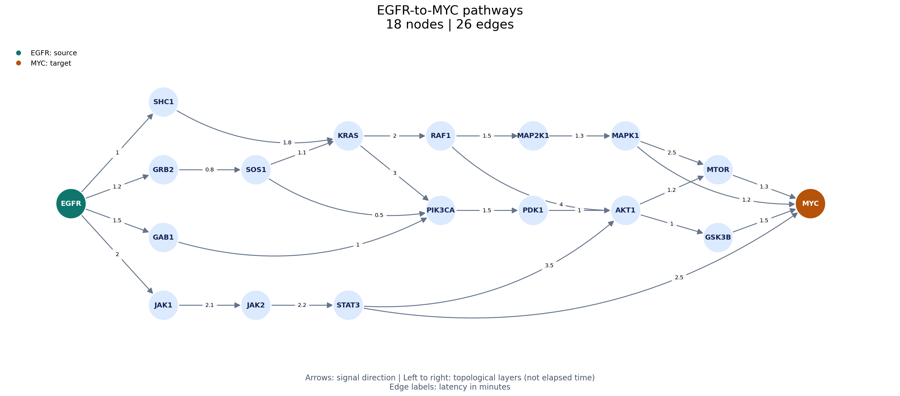

# Dynamic Programming — EGFR-to-MYC Signaling

[Back to course portfolio](../README.md)

**Course:** BIS/CBB 634 — Computational Methods for Informatics, Fall 2026

**Author:** Liam Lian (xl758)

This exercise analyzes a synthetic directed signaling network using forward and reverse dynamic programming (DP). It computes minimum EGFR-to-MYC latency, counts co-optimal pathways, and identifies intermediate nodes shared by every shortest pathway. Edge weights represent post-translational signal-transduction latency in minutes. These synthetic results are not evidence about real therapeutic targets.

## Code and outputs

- [Executed notebook](dp.ipynb): forward DP, reverse DP, network views, saved results, validation, and analytical answers.
- [DP implementation](dp_intro.py): `analyze_network()` returns the assignment's `(min_latency, co_optimal_path_count, bottlenecks)` tuple; `network_details()` also exposes `D`, `C`, `R`, and `F`. Earlier `forward_dp()` and `minimum_latencies()` calls remain available.
- [Visualization code](visualize_network.py): complete network and the subnetwork on EGFR-to-MYC paths.
- [Validation code](validate_dp.py): hand-checkable cases and independent exhaustive path enumeration using decimal arithmetic.
- [Result summary](results.json), [all-node DP table](node_results.csv), and [four optimal pathways](optimal_paths.csv).
- [Dependencies](requirements.txt).

Download `egfr_myc_large_network.csv` from the [assignment's Canvas file link](https://yale.instructure.com/courses/121398/files/13351052/download?download_frd=1) and place it directly in this folder. The original assignment PDF and input CSV remain local and are excluded from Git. All exercise files are kept in this folder.

The input used here contains 81 nodes and 141 unique directed edges. Its SHA-256 is `150ac54b98a7cb04170a4094b66362f97fbce70fb95396d78b94a86dad2a7746`.

From this folder:

```bash
python -m pip install -r requirements.txt
python dp_intro.py
python validate_dp.py
```

Run all cells of `dp.ipynb` to reproduce the tables, figures, and saved result artifacts. Plotting and validation use supporting libraries; the shortest-path and bottleneck calculations are custom DP implementations.

## Task 1 — Forward DP Sweep (Min Latency & Path Multiplicity)

`D[v]` is the minimum latency from EGFR to `v`, and `C[v]` is the number of paths attaining it. Initialize `D[EGFR] = 0` and `C[EGFR] = 1`; all other distances are infinite and counts are zero. The source count represents the one empty path at the source. Kahn's algorithm processes nodes only after all incoming dependencies have been removed. Alphabetical sorting or sorting by initial in-degree cannot provide that guarantee.

The maintained `_forward_sweep()` performs the following update after initialization:

```python
for u in topo_order:
    if D[u] == float("inf"):
        continue

    for v, weight in adj[u]:
        candidate = D[u] + weight

        if candidate < D[v] - EPSILON:
            D[v] = candidate
            C[v] = C[u]
        elif abs(candidate - D[v]) <= EPSILON:
            C[v] += C[u]
```

A strictly better candidate replaces both the previous distance and its obsolete path count. A tied candidate adds all optimal prefixes reaching `u`, rather than adding just one. A longer candidate changes neither value. At PIK3CA, routes through GAB1 and SOS1 both arrive at 2.5 minutes, giving `C[PIK3CA] = 2`. The route through KRAS takes 5.8 minutes and is excluded from that count.

The assignment's `EPSILON = 1e-6` is an absolute floating-point precision guard in minutes. It is not the biological near-optimal allowance in Question 2. The supplied weights are specified to at most two decimal places, and exact-decimal enumeration confirms the reported ties. For general inputs with distinct latencies extremely close to this tolerance, local approximate equality is not a substitute for a globally defined near-optimal path budget.

## Task 2 — Reverse DP Sweep & Bottleneck Target Identification

`R[v]` counts continuations from `v` to MYC along forward-tight edges: those satisfying `D[u] + weight = D[v]` within the precision guard. Seeding only MYC ensures that tight branches that never reach MYC contribute zero. For a reachable target, the implementation is:

```python
R[target] = 1
for v in reversed(topo_order):
    if R[v] == 0:
        continue
    for u, weight in rev_adj[v]:
        if abs((D[u] + weight) - D[v]) <= EPSILON:
            R[u] += R[v]
```

Every optimal prefix to `v` can be combined with every tight continuation to MYC. Because the graph is acyclic, the prefix and suffix cannot intersect elsewhere and form a cycle. Thus `F[v] = C[v] * R[v]` counts complete shortest paths passing through `v`.

A node is a bottleneck when `F[v] == C[MYC]`, excluding EGFR and MYC themselves. If MYC is unreachable, the implementation returns infinite latency, zero paths, and an empty bottleneck list; the explicit positive-total check prevents the false conclusion that every zero-frequency node is a bottleneck.

| Node | D (minutes) | C | R | F = C × R | Intermediate bottleneck |
|---|---:|---:|---:|---:|---|
| EGFR | 0.0 | 1 | 4 | 4 | Excluded: source |
| GAB1 | 1.5 | 1 | 2 | 2 | No |
| GRB2 | 1.2 | 1 | 2 | 2 | No |
| SOS1 | 2.0 | 1 | 2 | 2 | No |
| PIK3CA | 2.5 | 2 | 2 | 4 | Yes |
| PDK1 | 4.0 | 2 | 2 | 4 | Yes |
| AKT1 | 5.0 | 2 | 2 | 4 | Yes |
| GSK3B | 6.0 | 2 | 1 | 2 | No |
| MTOR | 6.2 | 2 | 1 | 2 | No |
| MYC | 7.5 | 4 | 1 | 4 | Excluded: target |

Graph construction, Kahn's ordering, the two sweeps, and frequency calculation each take O(|V| + |E|) work in the usual unit-cost arithmetic model. Adjacency storage takes O(|V| + |E|) space and the DP tables take O(|V|). Sorting the final list of B bottleneck names adds O(B log B); sorting the exported node table is also presentation work, not part of the linear DP sweeps. Python integer counts do not overflow, although very large counts require more than constant-time arithmetic.

## Questions

### 1. Experimental Results

```text
Minimum EGFR-to-MYC latency: 7.50 minutes
Co-optimal path count: 4
Bottleneck target genes: ['AKT1', 'PDK1', 'PIK3CA']
```

The four shortest paths combine two prefixes with two suffixes. The prefixes are `EGFR -> GAB1 -> PIK3CA` and `EGFR -> GRB2 -> SOS1 -> PIK3CA`, each taking 2.5 minutes. Both then traverse `PIK3CA -> PDK1 -> AKT1`, adding 2.5 minutes. Finally, either `AKT1 -> GSK3B -> MYC` or `AKT1 -> MTOR -> MYC` adds 2.5 minutes. The total is 7.5 minutes for all four combinations.



This view contains 18 nodes and 26 edges on any EGFR-to-MYC path, including slower alternatives. Arrows show direction; edge labels show minutes. Horizontal position follows dependency layers, not elapsed time. The [complete network view](full_network.png) also includes other sources, branches, and MYC downstream nodes.

PIK3CA, PDK1, and AKT1 lie on every shortest path, but not on every possible path. For example, `EGFR -> JAK1 -> JAK2 -> STAT3 -> MYC` takes 8.8 minutes and avoids all three. Their bottleneck status therefore does not imply that removing them eliminates every route to MYC.

### 2. Near-Optimal Signaling Dynamics (delta-Optimal Paths)

To count every path with total latency at most `D[MYC] + delta`, retain a distribution of path counts by accumulated latency at each node, rather than only its best distance and one count. Define `H[v][ell]` as the number of source-to-`v` paths with total latency `ell`. Initialize `H[EGFR][0] = 1` and all other states to zero. In topological order, propagate each state along each outgoing edge:

```text
budget = D[MYC] + delta
H[source][0] = 1
for u in topo_order:
    for (v, weight) in adj[u]:
        for (latency, count) in H[u]:
            new_latency = latency + weight
            if new_latency <= budget:
                H[v][new_latency] += count
answer = sum(H[MYC][latency] for latency <= budget)
```

This is a formulation, not an additional implemented solver. Positive weights make it safe to discard prefixes already exceeding the total budget. A further safe pruning rule uses a shortest remaining distance `d_to_target[v]`: discard a state if `new_latency + d_to_target[v] > budget`.

A single count loses the information needed to decide which prefixes remain feasible. For example, if two prefixes reach a node at 5.0 and 5.3 minutes and the remaining route costs 2.5 minutes, a total budget of 7.7 admits only the first. The ordinary shortest-path count discards the second prefix entirely, even though it would become eligible at a budget of 7.8. Simply increasing `EPSILON` cannot recover this missing distribution or enforce a total-path budget.

For this dataset, exact integer units of 0.01 minute are possible by parsing decimal weights and scaling them by 100. With budget index B = floor((D[MYC] + delta) / 0.01), a dense latency-state DP takes O(|E| B + |V| B) time and O(|V| B) space. This is pseudopolynomial in the numerical budget. For arbitrary real-valued weights, a sparse map of exact accumulated costs can have exponentially many distinct states; quantizing to bins controls size but introduces an approximation whose boundary effects must be stated. The extra state is accumulated latency (or equivalently remaining budget), not just path multiplicity.

### 3. Graph DP vs. Grid DP

Topological order and nested matrix loops both schedule subproblems so that every dependency is solved before it is used. In Smith-Waterman, cell `(i, j)` depends on `(i - 1, j)`, `(i, j - 1)`, and `(i - 1, j - 1)`; increasing row and column loops respect those dependencies. The grid itself therefore supplies an implicit topological order. The local-alignment zero reset changes the recurrence's values, not this scheduling requirement.

An arbitrary DAG has no regular row-column geometry. Kahn's algorithm constructs a legal order by repeatedly removing zero-remaining-in-degree nodes. Once all parents of `v` have contributed, `D[v]` and `C[v]` are final and can be used downstream. Reversing the same order makes successor-dependent quantities such as `R[v]` available before they are propagated upstream. Different valid orders give the same mathematical result; alphabetical names and initial in-degree values are not sufficient dependency schedules.

### 4. Biological Feedback Loops

With a directed cycle, Kahn's algorithm eventually exhausts its queue while some vertices remain unprocessed. Each node on the cycle still depends on another cycle node, so no complete topological order exists. The supplied implementation detects this by comparing the output-order length with the total node count and raises `ValueError`, even if the cycle is outside the EGFR-to-MYC region. A single DAG sweep cannot finalize values under circular dependencies.

Strictly positive edge weights still make the shortest distance well-defined for a reachable target in a finite graph: any walk containing a cycle can be shortened by deleting that positive-cost cycle, so a shortest route can be chosen among the finite set of simple paths. An unreachable target has distance infinity. Dijkstra's algorithm is an appropriate alternative for positive weights. After distances are known, exact shortest-path edges strictly increase distance, so they form an acyclic shortest-path subgraph on which counting can be performed. Positive cycles do not cause the unbounded distance decreases associated with negative cycles.

## Validation

All 11 tests in `validate_dp.py` pass. They cover a unique path, branching/merging and a dead end, replacement of obsolete counts, a floating-point tie, unreachable targets, cycle rejection, malformed inputs and nonpositive/nonfinite weights, a source equal to the target, the earlier distance-only interface, 40 seeded small DAGs, and the supplied dataset with five shuffled row orders.

Independent depth-first enumeration finds 19 complete EGFR-to-MYC paths in the supplied graph. Exact decimal summation identifies four minima at 7.5 minutes; their node intersection is `{AKT1, PDK1, PIK3CA}`. Per-node frequencies from enumeration also agree with `C[v] * R[v]`. This exhaustive method is a validation oracle for these small graphs, not a scalable replacement for DP. The final notebook was executed from a fresh kernel during assisted closeout.

The input contract is a nonempty DAG edge list with finite positive weights and unique ordered node pairs. Duplicate edges are rejected so the path-counting and simple-graph visualization interpretations remain consistent.

## Code evolution and design choices

I began by asking for an explanation of the biological setting and a minimum-latency implementation based on the supplied starter code. I then asked for a network visualization and a step-by-step walkthrough of the actual weights. The focused view made the branching and merging structure easier to follow while retaining the full graph as context.

I next asked to add forward path counts and discussed why a better route replaces a count while a tied route adds the predecessor's count. During assisted completion, the same forward recurrence was factored into a shared helper and extended with reverse counts, rather than duplicating the algorithm in the notebook. The earlier notebook interfaces were preserved, and `analyze_network()` now provides the assignment's requested return format. Exposing the full node tables makes the bottleneck calculation inspectable.

The precision guard follows the assignment. Keeping near-optimal counting as a separate latency-state formulation avoids conflating numerical equality with biological timing variation. The final implementation also explicitly handles unreachable targets and validates the input assumptions; exhaustive path enumeration is confined to verification.

## AI assistance

I used OpenAI Codex to explain the biological model and DP recurrences, generate and revise Python code, build the network visualizations, discuss bottlenecks, and help write the analytical answers and README. I requested the progression from minimum latency to forward path counts and then full exercise completion. My saved notebook contained executed minimum-latency and visualization cells before closeout. Codex implemented the reverse sweep, ran the automated checks and final notebook, and prepared the repository update. Those assisted checks are not a claim that I independently implemented or personally verified every part. I remain responsible for the submitted work and for being able to explain its reasoning.
