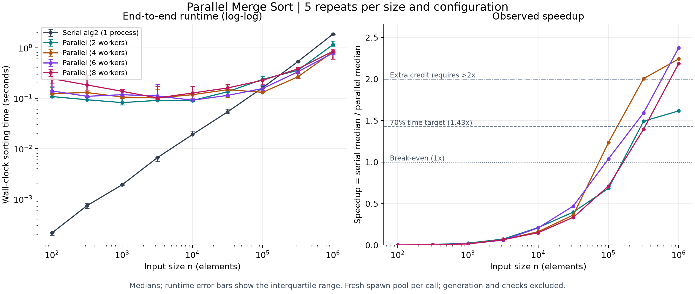

# Parallel Programming — Merge Sort

[Back to course portfolio](../README.md)

**Course:** BIS/CBB 634 — Computational Methods for Informatics, Fall 2026

**Author:** Liam Lian (xl758)

This exercise parallelizes the previous studio's Merge Sort (`alg2`) using Python's `multiprocessing` module. The implementation preserves the serial baseline and distributes independent sorting tasks across a fixed worker pool.

## Code and outputs

- [parallel_sort.py](parallel_sort.py): unchanged serial `alg2`, a two-way merge helper, and `parallel_alg2`.
- [test_parallel_sort.py](test_parallel_sort.py): automated correctness checks against both `alg2` and Python's `sorted()`.
- [benchmark.py](benchmark.py): reproducible timing, summary generation, and separate plotting commands.
- Current 2/4/6/8-worker experiment: [raw timings](benchmark-workers-2468-runs.csv), [summary](benchmark-workers-2468-summary.csv), [environment](benchmark-workers-2468-environment.json), [PNG](benchmark-workers-2468-scaling.png), and [SVG](benchmark-workers-2468-scaling.svg).

The input lists are generated reproducibly by the benchmark; no external dataset is required. Sorting, tests, and timing use only the Python standard library. Plotting requires Matplotlib, listed in [requirements.txt](requirements.txt). Run these commands from this folder:

```bash
python3 parallel_sort.py
python3 test_parallel_sort.py
```

To repeat the current comparison without replacing recorded measurements:

```bash
python3 benchmark.py --workers 2 4 6 8 --prefix benchmark-workers-2468-rerun
python3 -m pip install -r requirements.txt
python3 benchmark.py --prefix benchmark-workers-2468-rerun --plot-only
```

Use `python3 benchmark.py --prefix benchmark-workers-2468 --plot-only` to regenerate the current chart. The timing command refuses to overwrite existing measurements. Plotting runs separately; timing workers do not import Matplotlib. The plotting command reads worker counts from the saved data. Always pass `--workers 2 4 6 8` to collect the current comparison; the generic script's legacy default is 2 and 4.

The demonstration sorts `[8, 3, 7, 1, 6, 2, 5, 4]` using two workers. Execution is protected by `if __name__ == "__main__":` so spawned processes can safely import the module. Run multiprocessing calls from a guarded script rather than an interactive notebook cell.

## 1a — Parallel architecture and granularity design

### Partitioning and worker management

For an input of length `n` and a requested worker count `p`, partition the list into `min(p, n)` contiguous, nonempty blocks whose sizes differ by at most one. Submit one block to each task in a fixed process pool. Each worker sorts its block using the exact serial `alg2`; recursion within that worker does not create any additional processes.

Similar block sizes balance the sorting workload. The chunks are independent until their sorted results are returned, making them suitable for concurrent execution. This design uses `multiprocessing` for a single-machine implementation; it does not assume a distributed cluster.

### Why not spawn processes recursively?

A Merge Sort recursion tree terminating at `n` singleton leaves has `2n - 1` nodes for `n >= 1`. Creating two child processes at every internal node would therefore create `2n - 2` child processes in total. This is O(n) process creation, not necessarily O(n) processes executing simultaneously. Process startup, scheduling/context switching, memory use, and inter-process communication would become disproportionate to the tiny sorting tasks near the leaves.

A fixed pool bounds the number of worker processes. Coarse tasks amortize scheduling and serialization costs over substantial sorting work. One balanced block per worker is the initial granularity choice; the best worker count requires measurement.

### Merging sorted blocks

The coordinator merges returned blocks in balanced pairwise rounds. For four sorted blocks, merge A with B and C with D, then merge AB with CD. An unmatched block in an odd-sized round carries forward unchanged. The coordinator executes these merges serially.

The `merge_sorted` helper uses the same `<` comparison and iterator-exhaustion logic as the baseline's merge stage, with explicit handling for empty inputs. It does not call `sorted()` or re-sort concatenated blocks. This keeps the merge strategy transparent for the later performance comparison.

### Work versus elapsed time

Parallelization does not reduce the asymptotic total sorting work. For `p` balanced blocks, block sorting requires O(n log(n/p)) total work, and the pairwise merge rounds require O(n log p). Together they remain O(n log n), as in serial Merge Sort. The intended benefit is simultaneous execution of independent work, reducing wall-clock time rather than eliminating comparisons.

Process startup, data serialization and transfer, and coordinator-side merging add overhead or serial work. More workers therefore do not guarantee proportional speedup. The list-based implementation also incurs memory costs for chunks, serialized data, and returned results; it is an in-memory design.

### Cutoff and fair comparison

`parallel_alg2(data, num_workers=2, min_parallel_size=2)` exposes a configurable whole-input cutoff. Inputs below that cutoff, empty/singleton inputs, and one-worker requests call `alg2` directly. The default cutoff of 2 excludes only trivial inputs; it is not an experimentally selected crossover point. This leaves nontrivial small inputs on the parallel path so their overhead can be observed. A useful performance cutoff can be selected after benchmarking.

Each parallel call creates and closes its own pool. End-to-end sorting measurements include this startup/cleanup, partitioning, transfer, and final merging, while excluding data generation. Serial fallback cases must be identified when interpreting scaling results. The original serial `alg2` remains unchanged so an unrelated serial optimization is not presented as parallel speedup.

## 1b — Implementation and correctness verification

The implementation explicitly uses the `spawn` start method. Its worker function is defined at module level, and all script execution is guarded. The pool sorts the blocks, closes, and returns control to the coordinator for pairwise merging. Requested workers are capped at the number of input elements to avoid empty-block tasks.

The core implementation below is an excerpt from `parallel_alg2`, after argument validation and the serial-fallback checks, where `n = len(data)`. It uses the module-level unchanged `alg2` and the `merge_sorted` helper from the same file; it is not a standalone script.

```python
workers = min(num_workers, n)
block_size, extra = divmod(n, workers)
chunks = []
start = 0
for i in range(workers):
    end = start + block_size + (i < extra)
    chunks.append(data[start:end])
    start = end

# Top-level alg2 is importable by spawned workers; it never creates a pool.
with mp.get_context("spawn").Pool(processes=workers) as pool:
    runs = pool.map(alg2, chunks, chunksize=1)

# An unmatched run is carried forward when a round has an odd run count.
while len(runs) > 1:
    next_runs = []
    for i in range(0, len(runs), 2):
        if i + 1 == len(runs):
            next_runs.append(runs[i])
        else:
            next_runs.append(merge_sorted(runs[i], runs[i + 1]))
    runs = next_runs
return runs[0]
```

The two-worker demonstration prints:

```text
[1, 2, 3, 4, 5, 6, 7, 8]
```

The input contract is a Python list of mutually comparable, picklable values; the tests use integers and finite floating-point values. The function does not mutate its input. NaN ordering and stable ordering of distinct objects with equal keys are outside these tests; the supplied baseline selects from the right on ties and is not a stable-sort reference.

The test suite checks:

- Empty and single-element lists.
- Duplicate values and all-equal lists.
- Odd input lengths, uneven blocks, and an odd number of merge runs.
- Already sorted and reverse-sorted inputs.
- More requested workers than elements.
- Seeded random inputs of 100,001 integers and 10,001 finite floats, using seed 634.
- One-worker and cutoff fallbacks, the cutoff boundary, input preservation, merge exhaustion, and invalid worker/cutoff settings.

Every end-to-end case compares the parallel output with both the unchanged `alg2` and the independent `sorted()` reference. Nontrivial cases exercise real spawned workers with 2, 3, and 4 workers. Correctness tests do not establish a performance gain; benchmark results and the assignment's speed targets require separate measurements.

Validation on November 19, 2026: all 9 test methods passed on macOS with Python 3.12.6 using real spawned processes. A separate AST comparison confirmed that the serial `alg2` matches the previous studio notebook exactly. These checks were executed by Codex; all nine tests also passed during the final closeout. The saved benchmark summaries and source hashes were rechecked without rerunning the timing sweep.

## 1c — Benchmarking and log-log scaling analysis

The final comparison uses **2, 4, 6, and 8 workers**. Only this experiment supplies the published tables, chart, and 1d calculations. Earlier experiments remain local and are not pooled with this run.

### Method and reproducibility

The recorded experiment ran on November 19, 2026, on an Apple M3 with 8 physical/logical CPU cores and 16 GiB RAM, running macOS 14.6 and Python 3.12.6 (arm64). CPU and memory specifications were read using `sysctl`; interpreter and run details are stored in the environment JSON. Worker counts describe processes, not pinned CPU cores: operating-system scheduling and background activity were not controlled.

The current experiment compares the unchanged serial `alg2` with 2-worker, 4-worker, 6-worker, and 8-worker `parallel_alg2`. All five configurations were measured together in a new run; earlier serial timings were not reused. Nine sizes, rounded from `10 ** (2 + i / 2)` for `i = 0, ..., 8`, cover 100 through 1,000,000 elements. Each size/configuration has five repetitions, for 225 timed sorts. All 225 outputs matched Python's independent `sorted()` reference, and all inputs remained unchanged. Each configuration also received one untimed warmup on 10,000 elements.

Inputs are random integer lists drawn uniformly from -1,000,000,000 through 1,000,000,000. The base seed is 634; each size/repetition uses `634 + n * 1009 + repeat`, so repetitions have different reproducible data. Within a repetition, all five configurations receive independent copies of the same values. Configuration order is shuffled with a separate deterministic seed (`data_seed + 7919`), and measurements run sequentially.

`time.perf_counter()` brackets the entire sorting call. Input generation, preparation of the external input copy, reference sorting, correctness checks, printing, and file/plot output are outside the timer. Internal splitting/copying, a fresh `spawn` pool, serialization/IPC, worker sorting, pool cleanup, and coordinator merging are all included. The cutoff remains 2, so every measured parallel configuration uses the parallel path. No sorting implementation or cutoff was tuned during the run; the implementation's SHA-256 was checked before and after.

The primary statistic is the median of five times. Runtime error bars show inclusive sample quartiles (Q1–Q3), not confidence intervals. The summary CSV also retains minima and maxima; the raw CSV retains every trial, input seed, execution order, and correctness result. Speedup is the ratio of the serial median to the parallel median, not the median of paired trial ratios. Five repetitions describe observed variability but do not establish a universal performance guarantee.

### Observed results



The left panel uses logarithmic axes for input size and wall-clock seconds; the right panel shows the ratio of medians against the 1×, 1.43×, and 2× reference lines. All times below are median seconds from the final experiment.

| Input size n | Serial | 2 workers | 4 workers | 6 workers | 8 workers |
|---:|---:|---:|---:|---:|---:|
| 100 | 0.000212 | 0.107582 | 0.123548 | 0.139002 | 0.243572 |
| 316 | 0.000739 | 0.092968 | 0.129118 | 0.108744 | 0.182794 |
| 1,000 | 0.001919 | 0.081629 | 0.105192 | 0.117078 | 0.136712 |
| 3,162 | 0.006594 | 0.090248 | 0.100930 | 0.110401 | 0.101062 |
| 10,000 | 0.018959 | 0.089620 | 0.117095 | 0.091067 | 0.126455 |
| 31,623 | 0.053414 | 0.134039 | 0.147121 | 0.113385 | 0.159174 |
| 100,000 | 0.161436 | 0.235951 | 0.130589 | 0.155384 | 0.226928 |
| 316,228 | 0.530417 | 0.355456 | 0.264546 | 0.333087 | 0.379940 |
| 1,000,000 | 1.861753 | 1.151591 | 0.830460 | 0.783140 | 0.851225 |

For n = 1,000,000, the serial median is 1.8618 seconds:

| Workers | Median (s) | Q1–Q3 (s) | Parallel / serial median | Speedup |
|---:|---:|---:|---:|---:|
| 2 | 1.1516 | 1.0771–1.3700 | 61.9% | 1.617× |
| 4 | 0.8305 | 0.7945–0.8628 | 44.6% | 2.242× |
| 6 | 0.7831 | 0.7315–0.8076 | 42.1% | 2.377× |
| 8 | 0.8512 | 0.5981–0.9422 | 45.7% | 2.187× |

Six workers have the lowest median at the largest tested input: 0.7831 seconds, a 2.377× speedup, taking about 5.7% less time than four workers and 8.0% less than eight. All four configurations meet the at-most-70% median-time criterion at this size; 4, 6, and 8 workers also meet the below-50% median-time criterion. These ratios of medians are not guarantees for every trial or claims that portfolio credit has been awarded.

The differences among 4, 6, and 8 workers are modest relative to the observed variability. Their runtime interquartile ranges overlap, and the eight-worker times range from 0.5784 to 1.3238 seconds. The result supports "six workers had the lowest median in this run," not a statistically established or universal optimum. No trial was discarded and no favorable baseline was selected from a different experiment.

At n = 316,228, four workers are fastest (0.2645 seconds), with a 2.005× median speedup only slightly above the 2× threshold. Four and six workers first beat the serial median at n = 100,000 on this grid; two and eight first do so at n = 316,228. These are first observed sampled crossings, not precisely located cutoffs. The six-worker advantage at n = 100,000 is only about 4% and should not be treated as a robust tuned threshold.

Small-input results remain dominated by parallel overhead: below n = 100,000 all measured parallel configurations are slower than serial. More workers create more processes and chunks; the coordinator still merges the sorted chunks serially. With six chunks, pairwise merging carries an unmatched run forward, so the merge tree is not perfectly balanced. These architectural features explain why worker count need not translate proportionally into speedup, but their individual time contributions were not profiled.

The implementation still performs O(n log n) total sorting work. The purpose of parallelization is to overlap independent work. These results cover one Apple M3, one integer input distribution, and this input-size range, with no CPU affinity, background-load, or thermal control. No claim of an optimal worker count outside this experiment or out-of-memory scalability is made. The sorting function's default remains 2; benchmark commands explicitly select the comparison set.

## 1d — Graduate critical thinking and systems analysis

The analysis below uses only the final 2/4/6/8-worker experiment in [benchmark-workers-2468-summary.csv](benchmark-workers-2468-summary.csv), its [raw measurements](benchmark-workers-2468-runs.csv), and the current implementation. Speedups are ratios of five-run median times, consistent with Section 1c.

### 1. The crossover point

For a fixed worker count p, the crossover size n* is approximately where parallel and serial runtimes become equal. In the current log-log plot, the first sampled size with a parallel median below the serial median depends on p:

| Workers p | Last sampled size slower than serial before the first crossing | First sampled size faster than serial | Observed crossover bracket |
|---:|---:|---:|---|
| 2 | 100,000 | 316,228 | 100,000–316,228 |
| 4 | 31,623 | 100,000 | 31,623–100,000 |
| 6 | 31,623 | 100,000 | 31,623–100,000 |
| 8 | 100,000 | 316,228 | 100,000–316,228 |

These brackets describe the measured grid, not exact mathematical thresholds or confidence intervals. For example, at n = 100,000, six workers take 0.155384 seconds versus 0.161436 seconds serial, only a 3.75% time reduction. That small advantage and the run-to-run variation do not justify treating 100,000 as an optimized cutoff. Finer sampling and repeated measurements near the crossings would be needed to select one reliably.

A useful conceptual decomposition is:

$$
T_p(n) \approx T_{\mathrm{setup/communication}}(n,p)
             + T_{\mathrm{worker\ sorting}}(n,p)
             + T_{\mathrm{coordinator\ merge}}(n,p).
$$

This is an explanatory decomposition, not a fitted timing model; some communication and computation can overlap. Every call starts a fresh pool, transfers the chunks and sorted results, and merges them in the coordinator. When n is small, serial sorting takes little time, so the work saved through concurrency cannot compensate for those costs. At n = 100, for example, serial sorting takes about 0.000212 seconds, while parallel medians range from 0.107582 to 0.243572 seconds. Increasing n increases the useful work per task, making the fixed startup cost less important relative to sorting. Serialization and final merging still grow with data size, so they do not disappear.

More workers can reduce block-sort time but also increase process-management costs and the number of chunks to merge. That trade-off explains why eight workers do not necessarily cross over earlier than four. It is consistent with the code and measurements, but individual overhead components were not profiled. The observed crossing should be interpreted as specific to the measured input distribution and runtime conditions.

### 2. Amdahl's Law and the serial merge bottleneck

Let f be the fraction of the original serial work that can be parallelized, and let p be the number of workers. Under ideal division of that work with no additional overhead, Amdahl's Law gives:

$$
S_p = \frac{1}{(1-f)+f/p}.
$$

Rearranging gives an effective parallelizable fraction from an observed speedup:

$$
\frac{1}{S_p}=1-f\left(1-\frac{1}{p}\right),
\qquad
f=\frac{1-1/S_p}{1-1/p}.
$$

The best ratio of medians in the final experiment occurs at n = 1,000,000 with six workers. Using the saved unrounded timings for calculation:

$$
T_1 = 1.861752625\ \mathrm{s},\qquad
T_6 = 0.783140500\ \mathrm{s},\qquad
S_6 = \frac{T_1}{T_6} \approx 2.377291.
$$

Therefore:

$$
f = \frac{1-1/2.377291}{1-1/6}
  \approx 0.695224,
\qquad
1-f \approx 0.304776.
$$

The fitted **effective parallelizable fraction is about 69.5%**, with an **effective serial fraction of about 30.5%**. Here p = 6 refers to the configured worker processes, not all eight available cores; treating them as six identical processing resources is a simplifying model assumption, since no CPU affinity or per-core throughput was measured.

The implementation identifies concrete limits on speedup:

| Stage in `parallel_alg2` | Role in the performance limit |
|---|---|
| The loop constructing `chunks` with list slices | The coordinator prepares the blocks before submitting the sorting tasks. |
| `mp.get_context("spawn").Pool(...)` and pool cleanup | Every call incurs process startup and lifecycle overhead inside the timer. |
| `pool.map(alg2, chunks, chunksize=1)` | Block sorts run concurrently, but inputs and results must be serialized and transferred. The coordinator waits for the returned runs before beginning the final merge phase. |
| `while len(runs) > 1` and calls to `merge_sorted` | All pairwise merge rounds execute sequentially in the coordinator; they are not dispatched to the workers. |

The final stage is a particularly clear serial bottleneck. Merging sorted runs costs O(n log p) coordinator work across the pairwise rounds, and the last merge alone processes all n elements. With six initial runs, the sequence of run counts is 6 → 3 → 2 → 1; an unmatched run is carried forward. Increasing p therefore does not simply divide the whole program's runtime by p.

The 30.5% estimate is **not** a measured share of time spent in merging, nor a fraction of source-code lines. Real execution includes new parallel overhead, waiting, memory effects, and scheduling variability that the ideal formula does not represent separately. The fitted f absorbs their impact and can change with n, p, and machine conditions. Assigning the entire residual to one function or predicting a guaranteed maximum speedup from it would require stronger evidence. Component profiling would be needed to distinguish startup, transfer, worker computation, and merging. Six workers also had only a modest median advantage over four and eight, with overlapping runtime variability; the calculation uses the best observed result as requested, without establishing six as universally optimal.

### 3. Python concurrency and distributed trade-offs

For the current single-machine problem, a local `multiprocessing` pool is a practical choice: each worker sorts an independent in-memory block, while the coordinator handles input partitioning and final merging. For a 100-node hospital cluster processing terabytes of records that cannot fit in one machine's RAM, MPI through `mpi4py` would be the more appropriate of the two options. It supports explicit communication among processes on different machines, each with its own memory. The present local pool does not automatically distribute its workers across those machines.

The change requires a different data flow, not just replacing an import. The current function assumes the full input is already in one coordinator's memory, returns every sorted block there, and constructs a complete final list there. These assumptions create memory and communication bottlenecks even if sorting itself is distributed.

A cluster design would need to:

1. **Read partitions near their storage.** Assign input partitions to nodes so a coordinator does not first load and transmit the entire dataset. Each node sorts its assigned records locally.
2. **Establish a global ordering across nodes.** Locally sorted partitions alone are insufficient if their key ranges overlap. A distributed range-partitioning design could choose splitters, exchange records into ordered key ranges, and merge received sorted runs locally. Boundaries and duplicate keys need a consistent assignment rule, and skewed key distributions require attention to load balance.
3. **Keep results distributed.** Write ordered output partitions with metadata describing their key ranges and sequence, instead of gathering every record onto one root process. Within-partition ordering, cross-partition boundaries, and record counts should be checked to validate the global result.
4. **Use external sorting when local RAM is insufficient.** Each node can read bounded batches, write sorted runs to disk, and merge those runs with bounded buffers. MPI supplies communication; it does not automatically provide out-of-core storage or remove RAM limits.

The performance trade-off shifts from local process overhead to network traffic, storage bandwidth, synchronization, and workload skew. Communication should be batched, and structured buffers can be considered to avoid repeatedly transferring large Python object graphs. A hierarchical design could combine communication across nodes with local computation within each node, but this has not been implemented or benchmarked here. The relevant principle is to distribute storage and merging as well as sorting, so that the coordinator does not remain the system-wide bottleneck.

## Code evolution and design choices

I first asked whether dividing the input across workers would reduce the amount of computation, apart from saving elapsed time through concurrency. After discussing the distinction between total work and wall-clock time with Codex, I selected its proposed fixed-pool design: balanced blocks sorted by the original `alg2`, followed by coordinator-side pairwise merging. Keeping recursion inside each worker avoids recursive process creation. Retaining the supplied baseline is an assignment requirement; choosing a coarse task per worker and serial final merging makes the implementation straightforward to inspect but leaves communication and merging on the critical path.

I approved a benchmark with logarithmically spaced sizes, five repetitions, paired input values, and complete sorting-call timing. The initial comparison used two and four workers. I then asked to test eight and sixteen, before settling on **two, four, six, and eight** for the final comparison. Codex implemented and executed those experiments. The final set was measured together with a new serial baseline so differences between runs would not be mistaken for worker-count effects. Earlier records remain local; the published analysis uses only the final experiment.

I discussed the results and the three systems-analysis questions before requesting the README write-up. Six workers have the lowest median at one million elements in the final experiment, but four are faster at 316,228 and the larger-input variability overlaps. I therefore retain an explicit worker-count parameter rather than treating one setting as universally optimal. The cutoff remains 2 so the benchmark exposes small-input overhead instead of hiding it behind a tuned serial fallback. The Amdahl estimate describes effective scaling under a simplified model, while the MPI discussion proposes a distributed data flow that has not been implemented.

## AI assistance

I used OpenAI Codex to explain parallel architecture, benchmarking, Amdahl's Law, and the single-machine versus cluster trade-offs. Codex proposed the initial architecture and benchmark method, generated the implementation and tests, ran the experiments, produced the plots, and helped write and organize the README. I asked about the computational benefit of partitioning, selected the design after discussion, requested the worker-count revisions, and chose the final 2/4/6/8 comparison.

The reported executions and checks were performed through Codex: nine correctness tests, the final 225 timed sorts with output checks, comparison of saved summaries with raw timings, source-hash and baseline-code checks, and visual inspection of the chart. These are assisted results, not a separately documented independent run or independent demonstration of code mastery by me. I retain responsibility for understanding and defending the work. No classroom partner contribution is claimed in this record.
