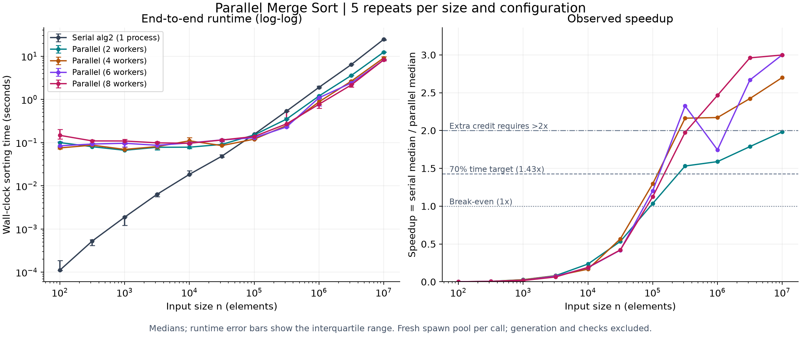
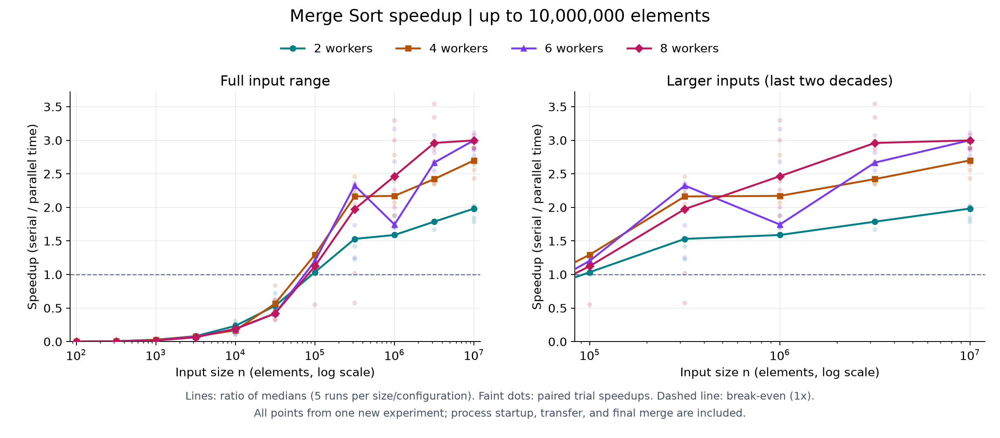

# Studio 8 — Parallel Programming: Merge Sort

[Back to course portfolio](../README.md)

**Course:** BIS/CBB 634 — Computational Methods for Informatics, Fall 2026

**Author:** Liam Lian (xl758)

This exercise parallelizes the previous studio's Merge Sort (`alg2`) using Python's `multiprocessing` module. The implementation preserves the serial baseline and distributes independent sorting tasks across a fixed worker pool.

## Code and outputs

- [parallel_sort.py](parallel_sort.py): unchanged serial `alg2`, a two-way merge helper, and `parallel_alg2`.
- [test_parallel_sort.py](test_parallel_sort.py): automated correctness checks against both `alg2` and Python's `sorted()`.
- [benchmark.py](benchmark.py): reproducible timing, summary generation, and log-log plotting.
- [plot_speedup_extension.py](plot_speedup_extension.py): full-range and large-input speedup plots with paired-trial scatter.
- Supplementary phase profiling: [report and reproduction commands](phase-profiling.md), [instrumentation](profile_phases.py), [raw records](profile-10m-68-runs.json), [summary](profile-10m-68-summary.csv), and [chart](profile-10m-68-phases.png).
- Current experiment through 10,000,000 elements: [raw timings](benchmark-large-2468-runs.csv), [summary](benchmark-large-2468-summary.csv), [environment](benchmark-large-2468-environment.json), [PNG](benchmark-large-2468-scaling.png), and [SVG](benchmark-large-2468-scaling.svg).
- Speedup detail: [PNG](benchmark-large-2468-speedup.png) and [SVG](benchmark-large-2468-speedup.svg).
- Previous experiment through 1,000,000 elements: [summary](benchmark-workers-2468-summary.csv) and [environment](benchmark-workers-2468-environment.json), retained as a historical record rather than pooled with the current run.

The input lists are generated reproducibly by the benchmark; no external dataset is required. Sorting, tests, and timing use only the Python standard library. Plotting requires Matplotlib, listed in [requirements.txt](requirements.txt). Run these commands from this folder:

```bash
python3 parallel_sort.py
python3 test_parallel_sort.py
```

To repeat the current comparison without replacing recorded measurements:

```bash
python3 benchmark.py --workers 2 4 6 8 --sizes 100 316 1000 3162 10000 31623 100000 316228 1000000 3162278 10000000 --prefix benchmark-large-2468-rerun
python3 -m pip install -r requirements.txt
python3 benchmark.py --prefix benchmark-large-2468-rerun --plot-only
python3 plot_speedup_extension.py --prefix benchmark-large-2468-rerun
```

Use `python3 benchmark.py --prefix benchmark-large-2468 --plot-only` to regenerate the runtime/scaling chart, and `python3 plot_speedup_extension.py --prefix benchmark-large-2468` for the speedup detail. The timing command refuses to overwrite existing measurements. Plotting runs separately; timing workers do not import Matplotlib. The plotting command reads worker counts from the saved data. Pass the explicit worker counts and sizes above to collect the current comparison; the generic script defaults remain 2/4 workers and sizes through 1,000,000.

The demonstration sorts `[8, 3, 7, 1, 6, 2, 5, 4]` using two workers. Execution is protected by `if __name__ == "__main__":` so spawned processes can safely import the module. Run multiprocessing calls from a guarded script rather than an interactive notebook cell.

## 1a — Parallel architecture and granularity design

### Partitioning and worker management

For an input of length `n` and a requested worker count `p`, partition the list into `min(p, n)` contiguous, nonempty blocks whose sizes differ by at most one. Submit one block to each task in a fixed process pool. Each worker sorts its block using the exact serial `alg2`; recursion within that worker does not create any additional processes.

Similar block sizes balance the sorting workload. The chunks are independent until their sorted results are returned, making them suitable for concurrent execution. This design uses `multiprocessing` for a single-machine implementation; it does not assume a distributed cluster.

### Why not spawn processes recursively?

A Merge Sort recursion tree terminating at `n` singleton leaves has `2n - 1` nodes for `n >= 1`. Creating two child processes at every internal node would therefore create `2n - 2` child processes in total. This is O(n) process creation, not necessarily O(n) processes executing simultaneously. Process startup, scheduling/context switching, memory use, and inter-process communication would become disproportionate to the tiny sorting tasks near the leaves.

A fixed pool bounds the number of worker processes. Coarse tasks amortize scheduling and serialization costs over substantial sorting work. One balanced block per worker is the initial granularity choice; the best worker count requires measurement.

### Merging sorted blocks

The coordinator merges returned blocks in balanced pairwise rounds. For four sorted blocks, merge A with B and C with D, then merge AB with CD. An unmatched block in an odd-sized round carries forward unchanged. The coordinator executes these merges serially.

The `merge_sorted` helper uses the same `<` comparison and iterator-exhaustion logic as the baseline's merge stage, with explicit handling for empty inputs. It does not call `sorted()` or re-sort concatenated blocks. This keeps the merge strategy transparent for the later performance comparison.

### Work versus elapsed time

Parallelization does not reduce the asymptotic total sorting work. For `p` balanced blocks, block sorting requires O(n log(n/p)) total work, and the pairwise merge rounds require O(n log p). Together they remain O(n log n), as in serial Merge Sort. The intended benefit is simultaneous execution of independent work, reducing wall-clock time rather than eliminating comparisons.

Process startup, data serialization and transfer, and coordinator-side merging add overhead or serial work. More workers therefore do not guarantee proportional speedup. The list-based implementation also incurs memory costs for chunks, serialized data, and returned results; it is an in-memory design.

### Cutoff and fair comparison

`parallel_alg2(data, num_workers=2, min_parallel_size=2)` exposes a configurable whole-input cutoff. Inputs below that cutoff, empty/singleton inputs, and one-worker requests call `alg2` directly. The default cutoff of 2 excludes only trivial inputs; it is not an experimentally selected crossover point. This leaves nontrivial small inputs on the parallel path so their overhead can be observed. A useful performance cutoff can be selected after benchmarking.

Each parallel call creates and closes its own pool. End-to-end sorting measurements include this startup/cleanup, partitioning, transfer, and final merging, while excluding data generation. Serial fallback cases must be identified when interpreting scaling results. The original serial `alg2` remains unchanged so an unrelated serial optimization is not presented as parallel speedup.

## 1b — Implementation and correctness verification

The implementation explicitly uses the `spawn` start method. Its worker function is defined at module level, and all script execution is guarded. The pool sorts the blocks, closes, and returns control to the coordinator for pairwise merging. Requested workers are capped at the number of input elements to avoid empty-block tasks.

The core implementation below is an excerpt from `parallel_alg2`, after argument validation and the serial-fallback checks, where `n = len(data)`. It uses the module-level unchanged `alg2` and the `merge_sorted` helper from the same file; it is not a standalone script.

```python
workers = min(num_workers, n)
block_size, extra = divmod(n, workers)
chunks = []
start = 0
for i in range(workers):
    end = start + block_size + (i < extra)
    chunks.append(data[start:end])
    start = end

# Top-level alg2 is importable by spawned workers; it never creates a pool.
with mp.get_context("spawn").Pool(processes=workers) as pool:
    runs = pool.map(alg2, chunks, chunksize=1)

# An unmatched run is carried forward when a round has an odd run count.
while len(runs) > 1:
    next_runs = []
    for i in range(0, len(runs), 2):
        if i + 1 == len(runs):
            next_runs.append(runs[i])
        else:
            next_runs.append(merge_sorted(runs[i], runs[i + 1]))
    runs = next_runs
return runs[0]
```

The two-worker demonstration prints:

```text
[1, 2, 3, 4, 5, 6, 7, 8]
```

The input contract is a Python list of mutually comparable, picklable values; the tests use integers and finite floating-point values. The function does not mutate its input. NaN ordering and stable ordering of distinct objects with equal keys are outside these tests; the supplied baseline selects from the right on ties and is not a stable-sort reference.

The test suite checks:

- Empty and single-element lists.
- Duplicate values and all-equal lists.
- Odd input lengths, uneven blocks, and an odd number of merge runs.
- Already sorted and reverse-sorted inputs.
- More requested workers than elements.
- Seeded random inputs of 100,001 integers and 10,001 finite floats, using seed 634.
- One-worker and cutoff fallbacks, the cutoff boundary, input preservation, merge exhaustion, and invalid worker/cutoff settings.

Every end-to-end case compares the parallel output with both the unchanged `alg2` and the independent `sorted()` reference. Nontrivial cases exercise real spawned workers with 2, 3, and 4 workers. Correctness tests do not establish a performance gain; benchmark results and the assignment's speed targets require separate measurements.

Validation on November 19, 2026: all 9 test methods passed on macOS with Python 3.12.6 using real spawned processes. A separate AST comparison confirmed that the serial `alg2` matches the previous studio notebook exactly. These checks were executed by Codex; all nine tests also passed during the final closeout. The saved benchmark summaries and source hashes were rechecked without rerunning the timing sweep.

## 1c — Benchmarking and log-log scaling analysis

The final comparison uses **2, 4, 6, and 8 workers**. The current tables, charts, and 1d calculations use the new experiment through 10,000,000 elements. Every size was remeasured with a contemporaneous serial baseline. The previously published one-million-element experiment is retained separately; no observations are pooled across runs.

### Method and reproducibility

The recorded experiment ran on November 19, 2026, on an Apple M3 with 8 physical/logical CPU cores and 16 GiB RAM, running macOS 14.6 and Python 3.12.6 (arm64). CPU and memory specifications were read using `sysctl`; interpreter and run details are stored in the environment JSON. Worker counts describe processes, not pinned CPU cores: operating-system scheduling and background activity were not controlled.

The current experiment compares the unchanged serial `alg2` with 2-worker, 4-worker, 6-worker, and 8-worker `parallel_alg2`. All five configurations were measured together in a new run; earlier serial timings were not reused. Eleven sizes, rounded from `10 ** (2 + i / 2)` for `i = 0, ..., 10`, cover 100 through 10,000,000 elements. Each size/configuration has five repetitions, for 275 timed sorts. All 275 outputs matched Python's independent `sorted()` reference, and all inputs remained unchanged. Each configuration also received one untimed warmup on 10,000 elements.

Inputs are random integer lists drawn uniformly from -1,000,000,000 through 1,000,000,000. The base seed is 634; each size/repetition uses `634 + n * 1009 + repeat`, so repetitions have different reproducible data. Within a repetition, all five configurations receive independent copies of the same values. Configuration order is shuffled with a separate deterministic seed (`data_seed + 7919`), and measurements run sequentially.

`time.perf_counter()` brackets the entire sorting call. Input generation, preparation of the external input copy, reference sorting, correctness checks, printing, and file/plot output are outside the timer. Internal splitting/copying, a fresh `spawn` pool, serialization/IPC, worker sorting, pool cleanup, and coordinator merging are all included. The cutoff remains 2, so every measured parallel configuration uses the parallel path. No sorting implementation or cutoff was tuned during the run; the implementation's SHA-256 was checked before and after.

The primary statistic is the median of five times. Runtime error bars show inclusive sample quartiles (Q1–Q3), not confidence intervals. The summary CSV also retains minima and maxima; the raw CSV retains every trial, input seed, execution order, and correctness result. Speedup is the ratio of the serial median to the parallel median, not the median of paired trial ratios. Five repetitions describe observed variability but do not establish a universal performance guarantee.

### Observed results



The left panel uses logarithmic axes for input size and wall-clock seconds; the right panel shows the ratio of medians against the 1×, 1.43×, and 2× reference lines. All times below are medians from the expanded experiment, not a combination of old and new measurements.

| Input size n | Serial (s) | 2 workers (s) | 4 workers (s) | 6 workers (s) | 8 workers (s) |
|---:|---:|---:|---:|---:|---:|
| 100 | 0.000111 | 0.100022 | 0.075231 | 0.084234 | 0.147124 |
| 316 | 0.000525 | 0.080294 | 0.087279 | 0.092584 | 0.109359 |
| 1,000 | 0.001877 | 0.066415 | 0.069541 | 0.096393 | 0.108899 |
| 3,162 | 0.006341 | 0.077875 | 0.080676 | 0.086614 | 0.098716 |
| 10,000 | 0.018389 | 0.078231 | 0.109882 | 0.098230 | 0.096328 |
| 31,623 | 0.048380 | 0.090629 | 0.085217 | 0.115388 | 0.114742 |
| 100,000 | 0.155532 | 0.150262 | 0.120002 | 0.129213 | 0.138265 |
| 316,228 | 0.536009 | 0.350074 | 0.247767 | 0.230462 | 0.271352 |
| 1,000,000 | 1.900762 | 1.196257 | 0.875283 | 1.089339 | 0.771125 |
| 3,162,278 | 6.409549 | 3.586064 | 2.646144 | 2.402718 | 2.164977 |
| 10,000,000 | 24.633972 | 12.425578 | 9.121487 | 8.209129 | 8.215352 |

### Full-credit and extra-credit performance

At n = 10,000,000, the serial median is 24.6340 seconds:

| Workers | Median (s) | Q1–Q3 (s) | Parallel / serial median | Speedup |
|---:|---:|---:|---:|---:|
| 2 | 12.4256 | 12.3210–12.6877 | 50.44% | 1.9825× |
| 4 | 9.1215 | 8.5573–9.6726 | 37.03% | 2.7007× |
| 6 | 8.2091 | 8.1609–8.4214 | 33.32% | 3.0008× |
| 8 | 8.2154 | 7.9052–8.3079 | 33.35% | 2.9985× |

All four configurations meet the at-most-70% median-time target at the largest size. Four, six, and eight workers also meet the strictly-below-50% target for the assignment's +5-point final-portfolio extra credit. Two workers take 50.44% of serial time (1.9825×), so they do not meet the extra-credit performance threshold even though rounded values approach 2×. Meeting a measured performance threshold is not a claim that portfolio credit has been awarded.

Six workers have the numerically lowest median at ten million elements, but the difference from eight workers is only 0.00622 seconds (about 0.076%). Their interquartile ranges overlap substantially. The evidence supports near-equal observed performance at that size, not a reliable advantage of six over eight. At 3,162,278 elements, eight workers have the lowest median, illustrating that the ranking depends on input size and runtime conditions.

### Speedup as input size increases



Both panels use a logarithmic input-size axis and a linear speedup axis; the right panel enlarges the last two decades. Lines represent ratios of medians, whereas faint dots are individual paired-trial speedups using the serial and parallel times from the same input/repetition. These dots show variability, not confidence intervals around the line.

Increasing the input size does not guarantee monotonically increasing speedup. In this run, the six-worker curve falls from 2.326× at n = 316,228 to 1.745× at n = 1,000,000, then rises to 2.668× and 3.001× at the two largest sizes. Runtime variability is visible in the scatter; its causes were not profiled. For eight workers, speedup rises from 2.961× to 2.999× as n grows from 3,162,278 to 10,000,000, an increase of only about 1.3%. That is evidence of diminishing gains over the last measured interval, not proof of a permanent plateau or a measured memory-bandwidth limit.

All four worker configurations first beat the serial median at n = 100,000 in this experiment. Below that sampled size, parallel overhead outweighs the observed benefit. The two-worker time reduction at n = 100,000 is only about 3.4%, so the first crossing should not be treated as a validated cutoff. Section 1d gives the crossover brackets and mechanism analysis.

The total sorting work remains O(n log n). Additional workers increase the number of processes and chunks while final merging remains serial; elapsed-time savings come from overlapping independent block sorts. The measurements cover one Apple M3, one integer input distribution, and the tested range, with no CPU-affinity, background-load, or thermal control. The sorting function's default remains 2; the benchmark explicitly selects 2/4/6/8 workers. No observations were discarded, and the plotted scatter and CSVs preserve the measured variability.

## 1d — Graduate critical thinking and systems analysis

The crossover and Amdahl calculations below use only the expanded 2/4/6/8-worker experiment through ten million elements in [benchmark-large-2468-summary.csv](benchmark-large-2468-summary.csv), its [raw measurements](benchmark-large-2468-runs.csv), and the current implementation. Speedups are ratios of five-run median times, consistent with Section 1c.

### 1. The crossover point

For a fixed worker count p, the crossover size n* is approximately where parallel and serial runtimes become equal. In the current log-log plot, all four configurations first have a parallel median below the serial median at n = 100,000:

| Workers p | Last sampled size slower than serial before the first crossing | First sampled size faster than serial | Observed crossover bracket |
|---:|---:|---:|---|
| 2 | 31,623 | 100,000 | 31,623–100,000 |
| 4 | 31,623 | 100,000 | 31,623–100,000 |
| 6 | 31,623 | 100,000 | 31,623–100,000 |
| 8 | 31,623 | 100,000 | 31,623–100,000 |

These brackets describe the measured grid, not exact mathematical thresholds or confidence intervals. For example, at n = 100,000, two workers take 0.150262 seconds versus 0.155532 seconds serial, only a 3.39% time reduction. That small advantage and the run-to-run variation do not justify treating 100,000 as an optimized cutoff. Finer sampling and repeated measurements near the crossings would be needed to select one reliably.

A useful conceptual decomposition is:

$$
T_p(n) \approx T_{\mathrm{setup/communication}}(n,p)
             + T_{\mathrm{worker\ sorting}}(n,p)
             + T_{\mathrm{coordinator\ merge}}(n,p).
$$

This is an explanatory decomposition, not a fitted timing model; some communication and computation can overlap. Every call starts a fresh pool, transfers the chunks and sorted results, and merges them in the coordinator. When n is small, serial sorting takes little time, so the work saved through concurrency cannot compensate for those costs. At n = 100, for example, serial sorting takes about 0.000111 seconds, while parallel medians range from 0.075231 to 0.147124 seconds. Increasing n increases the useful work per task, making the fixed startup cost less important relative to sorting. Serialization and final merging still grow with data size, so they do not disappear.

More workers can reduce block-sort time but also increase process-management costs and the number of chunks to merge. The common sampled bracket does not establish identical true crossover points: the grid is coarse, and the trade-off between useful work and overhead differs with worker count. It is consistent with the code and measurements, but individual overhead components were not profiled. The observed crossing should be interpreted as specific to the measured input distribution and runtime conditions.

### 2. Amdahl's Law and the serial merge bottleneck

Let f be the fraction of the original serial work that can be parallelized, and let p be the number of workers. Under ideal division of that work with no additional overhead, Amdahl's Law gives:

$$
S_p = \frac{1}{(1-f)+f/p}.
$$

Rearranging gives an effective parallelizable fraction from an observed speedup:

$$
\frac{1}{S_p}=1-f\left(1-\frac{1}{p}\right),
\qquad
f=\frac{1-1/S_p}{1-1/p}.
$$

The best ratio of medians in the final experiment occurs at n = 10,000,000 with six workers; its tiny numerical advantage over eight is not statistically established. Using the saved unrounded timings for calculation:

$$
T_1 = 24.633971750\ \mathrm{s},\qquad
T_6 = 8.209128750\ \mathrm{s},\qquad
S_6 = \frac{T_1}{T_6} \approx 3.000802.
$$

Therefore:

$$
f = \frac{1-1/3.000802}{1-1/6}
  \approx 0.800107,
\qquad
1-f \approx 0.199893.
$$

The fitted **effective parallelizable fraction is about 80.0%**, with an **effective serial fraction of about 20.0%**. Here p = 6 refers to the configured worker processes, not all eight available cores; treating them as six identical processing resources is a simplifying model assumption, since no CPU affinity or per-core throughput was measured.

The implementation identifies concrete limits on speedup:

| Stage in `parallel_alg2` | Role in the performance limit |
|---|---|
| The loop constructing `chunks` with list slices | The coordinator prepares the blocks before submitting the sorting tasks. |
| `mp.get_context("spawn").Pool(...)` and pool cleanup | Every call incurs process startup and lifecycle overhead inside the timer. |
| `pool.map(alg2, chunks, chunksize=1)` | Block sorts run concurrently, but inputs and results must be serialized and transferred. The coordinator waits for the returned runs before beginning the final merge phase. |
| `while len(runs) > 1` and calls to `merge_sorted` | All pairwise merge rounds execute sequentially in the coordinator; they are not dispatched to the workers. |

The final stage is a particularly clear serial bottleneck. Merging sorted runs costs O(n log p) coordinator work across the pairwise rounds, and the last merge alone processes all n elements. With six initial runs, the sequence of run counts is 6 → 3 → 2 → 1; an unmatched run is carried forward. Increasing p therefore does not simply divide the whole program's runtime by p.

The 20.0% estimate is **not** a measured share of time spent in merging, nor a fraction of source-code lines. Real execution includes new parallel overhead, waiting, memory effects, and scheduling variability that the ideal formula does not represent separately. The fitted f absorbs their impact and can change with n, p, and machine conditions. Assigning the entire residual to one function or predicting a guaranteed maximum speedup from it would require stronger evidence. Those benchmark timings did not separately measure startup, transfer, worker computation, and merging; the supplementary experiment below examines these stages in a later run. Six and eight workers are nearly tied at ten million elements; the calculation uses the best ratio of medians as requested without establishing six as optimal. The fitted f is specific to this input size and configuration. It must not be treated as an invariant of the code or used as a fixed ceiling for other data sizes. In a fixed-f Amdahl model, speedup approaches 1/(1-f) as p increases; our extension instead varies n at fixed p, so that limit is not evidence that the observed size-scaling curve has reached a plateau.

#### Why six and eight workers are nearly tied

At n = 10,000,000, six workers take 8.209129 seconds and eight take 8.215352 seconds, giving speedups of 3.000802× and 2.998529×. The median-time difference is only 0.00622 seconds (about 0.076%), much smaller than the observed run-to-run variation, and their interquartile ranges overlap substantially. These measurements show near-equal performance; they do not establish that six workers are reliably faster.

Moving from six to eight workers reduces each block's size and can shorten local sorting, but it does not parallelize the coordinator's final merge. The final merge still processes all ten million elements, and preparing, serializing, and transferring the data also remains necessary. Larger inputs amortize fixed process-startup costs, but data-dependent transfer and merge costs grow with input size. Additional processes can also introduce scheduling costs and competition for shared resources such as memory bandwidth. The observed tie is consistent with local-sort savings being offset by other costs or runtime variation; those original measurements alone cannot identify the dominant cause or demonstrate bandwidth saturation.

The fitted 80% fraction explains diminishing returns, but a fixed-f Amdahl model alone does **not** predict a tie. For illustration, normalize the serial runtime to 100 seconds and use the rounded f = 0.80:

| Workers | Idealized runtime calculation | Runtime (s) | Speedup |
|---:|---|---:|---:|
| 6 | 20 + 80 / 6 | 33.33 | 3.00× |
| 8 | 20 + 80 / 8 | 30.00 | 3.33× |

Thus, even ideal scaling of the parallel component would reduce total runtime by only about 10% from six to eight workers, although that component itself shrinks by 25%. With our 24.634-second serial baseline, this rounded model predicts about 7.39 seconds for eight workers; the observed median is 8.215 seconds. The discrepancy shows the limits of transferring the six-worker fit to eight workers. It cannot be assigned entirely to one overhead component, because the model also assumes ideal work division and equivalent worker throughput.

Fitting the same formula separately to the eight-worker observation gives:

$$
f_8 = \frac{1-1/2.998529}{1-1/8} \approx 0.761718 \approx 76.2\%.
$$

The change from about 80.0% to 76.2% describes the lower effective scaling efficiency at eight workers, not a change in the fraction of source code that can execute concurrently. Both estimates absorb the combined effects of serial work, parallel overhead, and imperfect scaling. These fitted values motivate measuring worker sorting, data transfer, and coordinator merging separately. Increasing the worker count alone had little observed benefit between six and eight at this input size in the original benchmark.

#### Supplementary phase profiling

A separate follow-up on November 19, 2026 compared six and eight workers at n = 10,000,000 with five paired repetitions of the original function, an instrumented version, and a no-sort data-transfer control. All 30 calls passed their result and input-preservation checks. The [full report](phase-profiling.md) includes the method, raw records, summary statistics, chart, and reproduction commands.

This follow-up **did not reproduce the original near-tie**: eight workers reduced mean total time by about 8.1% in both the original and instrumented versions. In the instrumented calls, the map phase (sorting plus overlapping transfer and waiting) fell from 3.362 to 2.916 seconds, while coordinator merging rose from 0.814 to 0.938 seconds. Extra merging offset about 28% of the map-phase saving. Eight runs require 30,000,000 merge element visits versus 26,666,668 for six runs. The standalone echo map took approximately 0.3 seconds; it is a communication control, not an additive phase or a pure IPC measurement.

Worker sorting remained the largest measured component, and serial merging limited the gain from additional workers. However, the unchanged original function also ran substantially faster overall than in the earlier benchmark, so this experiment cannot establish the specific cause of the earlier tie. Its results remain separate from the original benchmark and the approximately 80% Amdahl estimate. No new serial baseline was measured; the observed merge shares (about 19% and 24% of parallel runtime) have a different denominator from the fitted 20% effective serial fraction.

### 3. Python concurrency and distributed trade-offs

For the current single-machine problem, a local `multiprocessing` pool is a practical choice: each worker sorts an independent in-memory block, while the coordinator handles input partitioning and final merging. For a 100-node hospital cluster processing terabytes of records that cannot fit in one machine's RAM, MPI through `mpi4py` would be the more appropriate of the two options. It supports explicit communication among processes on different machines, each with its own memory. The present local pool does not automatically distribute its workers across those machines.

The change requires a different data flow, not just replacing an import. The current function assumes the full input is already in one coordinator's memory, returns every sorted block there, and constructs a complete final list there. These assumptions create memory and communication bottlenecks even if sorting itself is distributed.

A cluster design would need to:

1. **Read partitions near their storage.** Assign input partitions to nodes so a coordinator does not first load and transmit the entire dataset. Each node sorts its assigned records locally.
2. **Establish a global ordering across nodes.** Locally sorted partitions alone are insufficient if their key ranges overlap. A distributed range-partitioning design could choose splitters, exchange records into ordered key ranges, and merge received sorted runs locally. Boundaries and duplicate keys need a consistent assignment rule, and skewed key distributions require attention to load balance.
3. **Keep results distributed.** Write ordered output partitions with metadata describing their key ranges and sequence, instead of gathering every record onto one root process. Within-partition ordering, cross-partition boundaries, and record counts should be checked to validate the global result.
4. **Use external sorting when local RAM is insufficient.** Each node can read bounded batches, write sorted runs to disk, and merge those runs with bounded buffers. MPI supplies communication; it does not automatically provide out-of-core storage or remove RAM limits.

The performance trade-off shifts from local process overhead to network traffic, storage bandwidth, synchronization, and workload skew. Communication should be batched, and structured buffers can be considered to avoid repeatedly transferring large Python object graphs. A hierarchical design could combine communication across nodes with local computation within each node, but this has not been implemented or benchmarked here. The relevant principle is to distribute storage and merging as well as sorting, so that the coordinator does not remain the system-wide bottleneck.

## Code evolution and design choices

I first asked whether dividing the input across workers would reduce the amount of computation, apart from saving elapsed time through concurrency. After discussing the distinction between total work and wall-clock time with Codex, I selected its proposed fixed-pool design: balanced blocks sorted by the original `alg2`, followed by coordinator-side pairwise merging. Keeping recursion inside each worker avoids recursive process creation. Retaining the supplied baseline is an assignment requirement; choosing a coarse task per worker and serial final merging makes the implementation straightforward to inspect but leaves communication and merging on the critical path.

I approved a benchmark with logarithmically spaced sizes, five repetitions, paired input values, and complete sorting-call timing. The initial comparison used two and four workers. I then asked to test eight and sixteen, before settling on **two, four, six, and eight** for the final comparison. Codex implemented codes of those experiments. The final set was measured together with a new serial baseline so differences between runs would not be mistaken for worker-count effects. Earlier records remain separate; the main benchmark analysis uses only the expanded experiment; supplementary profiling is reported separately.

I discussed the results and the three systems-analysis questions before requesting the README write-up. I then asked whether speedup would keep increasing with input size and requested measurements through ten million elements. Codex remeasured all sizes with fresh serial baselines, retaining five repeats per configuration. The largest-input medians put six and eight workers almost level, while the eight-worker gains diminish over the last interval. I therefore retain an explicit worker-count parameter and report the variability rather than treating one setting as universally optimal or claiming a proven plateau. The cutoff remains 2 so the benchmark exposes small-input overhead instead of hiding it behind a tuned serial fallback. The Amdahl estimate describes effective scaling under a simplified model, while the MPI discussion proposes a distributed data flow that has not been implemented.

After discussing the near-tie, I requested phase measurements and approved publishing them as a supplementary experiment. The new controls showed a modest eight-worker advantage and extra coordinator merge work, so I retain both experiments and distinguish measured costs from unverified explanations of the earlier result.

## AI assistance

I used OpenAI Codex to explain parallel architecture, benchmarking, Amdahl's Law, and the single-machine versus cluster trade-offs. I asked about the computational benefit of partitioning, selected the design after discussion, requested the worker-count revisions, chose the final 2/4/6/8 comparison, and requested the input-size extension.

The reported executions and checks were performed through Codex: nine correctness tests, the expanded 275 timed sorts with output checks, comparison of saved summaries with raw timings, source-hash and baseline-code checks, and visual inspection of the chart. These are assisted results, not a separately documented independent run or independent demonstration of code mastery by me. I retain responsibility for understanding and defending the work. No classroom partner contribution is claimed in this record.

For the expanded-results update, Codex checked all saved medians, quartiles, speedups, paired-input records, and code hashes, updated the runtime and speedup figures, and recomputed the crossover brackets and effective Amdahl fractions. The unchanged sorting and benchmark implementations were not rerun solely for this documentation update.

For the supplementary profiling, Codex implemented and ran the instrumentation and controls, verified 30 recorded calls and timing accounting, and produced the report and chart. The publication update checked the saved statistics and links without rerunning or replacing the original benchmark.
