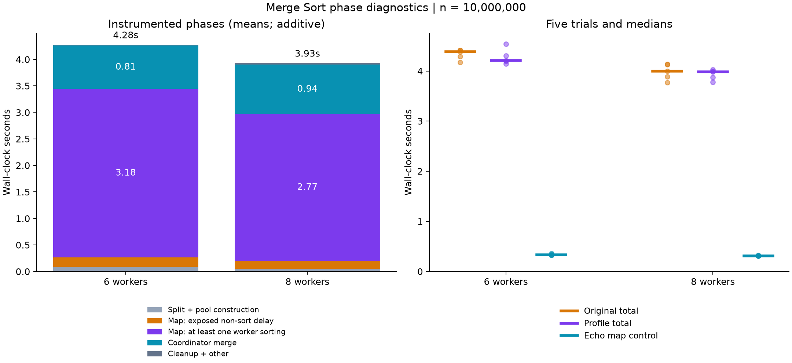

# Follow-up phase profiling: six versus eight workers

At ten million elements, this follow-up **did not reproduce the earlier near-tie**. Eight workers were faster in all five paired repetitions of both the original and instrumented functions. Worker sorting remained the largest elapsed-time component, while serial merging offset part of the benefit from adding workers. The measurements do not establish why the earlier run tied, or show that communication or memory bandwidth was its dominant bottleneck.

## Method and artifacts

On November 19, 2026, Codex ran [profile_phases.py](profile_phases.py) on the same reported hardware and interpreter as the original experiment: Apple M3, 8 physical/logical cores, 16 GiB RAM, macOS 14.6, Python 3.12.6. Hardware was rechecked with `sysctl`; AC power was observed during this follow-up. Earlier power, background-load and thermal conditions were not recorded, so the large difference in absolute runtimes cannot be attributed to a specific environmental cause.

Five repetitions each compare six configurations: original, instrumented and echo-only calls, each with six and eight workers. All configurations within a repetition use the same values, with the original seed formula and input distribution; their execution order is shuffled reproducibly. Every call creates a fresh spawn pool. Input generation/copying, reference sorting and result checks are outside the timer. All 20 sort results matched `sorted()`, all 10 echo results preserved the input order, and all 30 inputs remained unchanged. Warmups and a separate 12-call small-input smoke check also passed. The production sorting source is unchanged; source hashes, configuration order, timestamps, per-worker records and merge rounds are saved in the raw JSON.

- [Raw records and environment](profile-10m-68-runs.json)
- [Summary statistics](profile-10m-68-summary.csv)
- [PNG chart](profile-10m-68-phases.png) / [SVG chart](profile-10m-68-phases.svg)

Reproduce without overwriting these measurements:

```bash
python3 profile_phases.py --n 10000000 --repeats 5 --prefix profile-10m-68-rerun
python3 -m pip install -r requirements.txt
python3 profile_phases.py --prefix profile-10m-68-rerun --plot-only
```

The instrumented function reproduces the original partitioning, pool lifecycle, block sorting and pairwise coordinator merge, adding clocks around each stage. Each worker timestamps its `alg2` call after input deserialization and before output serialization. Per-worker durations overlap: summing them would measure accumulated worker time, not elapsed wall time. We retain their maximum and their interval union (time during which at least one worker is inside `alg2`). Worker CPU times are also recorded, but do not independently establish resource saturation.

`pool.map` includes worker readiness, task/result serialization, IPC, scheduling and sorting, some of which overlap. Its duration minus the union of worker sorting intervals is **exposed non-sort delay**, not total or pure communication time. The echo control transfers and returns equivalent integer-list payloads without sorting; its map time estimates a standalone round-trip cost, including readiness and scheduling. It is a different workload and cannot be subtracted as an additive phase of the sorting run. Pool construction returning does not guarantee that spawned workers are ready. These distinctions avoid mislabeling overlapping computation and transfer as disjoint measurements.

## Results

The following are **arithmetic means of five runs**, enabling additive phase comparisons. Rows nested conceptually within the map phase are not additional elapsed-time components; echo and original calls are separate controls.

| Measurement (seconds) | 6 workers | 8 workers |
|---|---:|---:|
| Original function total, separate control | 4.332 | 3.983 |
| Instrumented function total | 4.278 | 3.931 |
| Map phase: sorting plus overlapping transfers/waiting | 3.362 | 2.916 |
| Within map: union of worker sorting intervals | 3.181 | 2.766 |
| Within map: exposed non-sort delay | 0.181 | 0.150 |
| Slowest worker's local sorting duration | 3.066 | 2.635 |
| Coordinator merge | 0.814 | 0.938 |
| Echo-only map, separate communication control | 0.338 | 0.315 |
| Echo-only entire call, separate control | 0.394 | 0.386 |

The original-function medians are 4.383 and 3.999 seconds; the instrumented medians are 4.208 and 3.980 seconds. Instrumented totals are approximately 1.3% below original totals in the mean for both worker counts, within the observed variation between separate calls. The controls do not show a large instrumentation penalty, but they do not prove the timers are cost-free. The original-call paired reductions from six to eight workers range from 6.3% to 11.3%; the corresponding instrumented reductions range from 5.0% to 11.3%. No trial was discarded, and no serial baseline was collected in this diagnostic run, so no new serial-relative speedup is reported.



The stacked chart uses means so its components sum to mean total time. The right panel shows every trial and its configuration median. The echo control is plotted separately and is not part of either stacked total.

## Interpretation

**Sorting is still the largest component; merging limits the benefit from more workers.** The union of worker sorting intervals occupies about 74% and 70% of instrumented elapsed time for six and eight workers, respectively. Coordinator merging occupies about 19% and 24%. The standalone echo map costs about 0.3 seconds and is slightly shorter with eight workers. Together with the observed map intervals, these results do not support a claim that transfer dominates this follow-up. They also cannot exclude transfer contention hidden underneath worker sorting.

Eight workers save 0.446 seconds in the mean map phase, but incur 0.123 seconds more coordinator merging. The additional merge time offsets about 28% of the map-phase saving. Including changes in setup, cleanup and remaining overhead, the net mean saving is 0.347 seconds, or about 8.1% of the instrumented six-worker total. The original-function control independently shows an approximately 8.1% mean reduction.

The merge work explains the direction of that trade-off. Eight equal runs merge as 8 → 4 → 2 → 1, processing ten million elements in each of three rounds, or 30,000,000 element visits. Six balanced runs merge as 6 → 3 → 2 → 1; the unmatched run in the middle round is carried forward. The recorded merge rounds process 10,000,000 + 6,666,668 + 10,000,000 = 26,666,668 elements. Eight workers therefore require about 12.5% more merge element visits in this implementation; their measured mean merge time is about 15.1% longer. Visit counts explain additional work, not every timing difference.

**This is a new experiment, not a decomposition of the earlier 8.21-second result.** The original function now takes roughly four seconds, with the same recorded algorithm hash, input seeds and hardware/interpreter. Runtime conditions were not controlled sufficiently to explain that change. The earlier tie remains an observation from its own run. The follow-up demonstrates a concrete opposing effect—faster block sorting but more serial merge work—without proving that this effect alone caused the earlier tie or that six or eight is universally optimal.

The earlier 80% Amdahl estimate was fitted from the original experiment's serial-relative speedup. Its residual 20% refers to an effective fraction of the original serial baseline under a simplified model. The 19%/24% merge shares here instead divide measured merge time by this follow-up's parallel runtime. These have different denominators and experimental conditions; their numerical proximity does not validate an interpretation of the old 20% residual as measured merge time. A new Amdahl fit would require a contemporaneous serial baseline.

A useful next optimization experiment would target the coordinator merge and compare complete runtimes: additional parallel merge work may require extra transfers, and those costs must be included. These diagnostics identify measurable costs rather than establishing that such an optimization will necessarily be faster.

## AI assistance

The user requested phase measurements to investigate the six/eight-worker comparison. Codex designed and implemented the instrumentation and controls, executed the experiments, checked output correctness and timing accounting, generated and visually inspected the chart, and wrote this report. The original benchmark artifacts and sorting implementation were preserved. These are assisted measurements, not a separately documented independent student execution.
