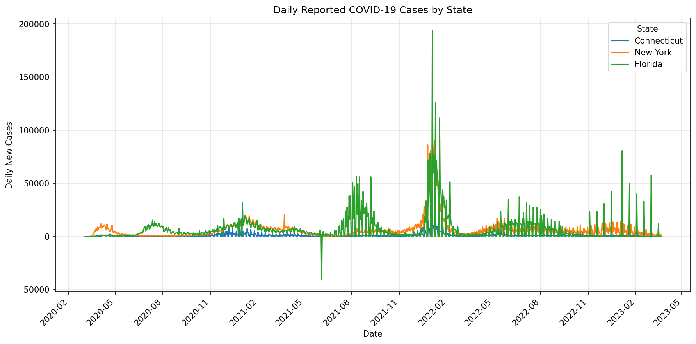
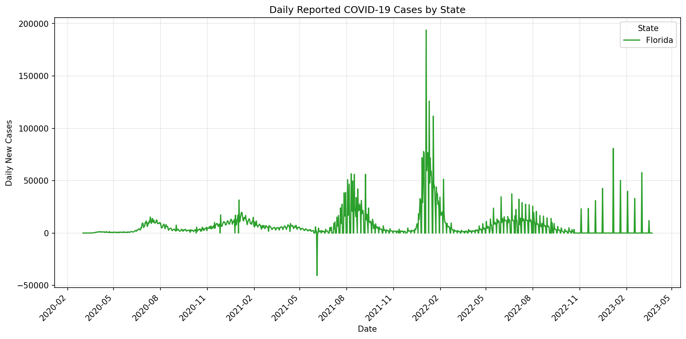
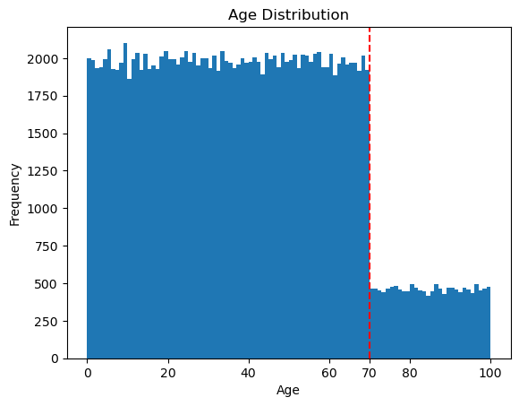
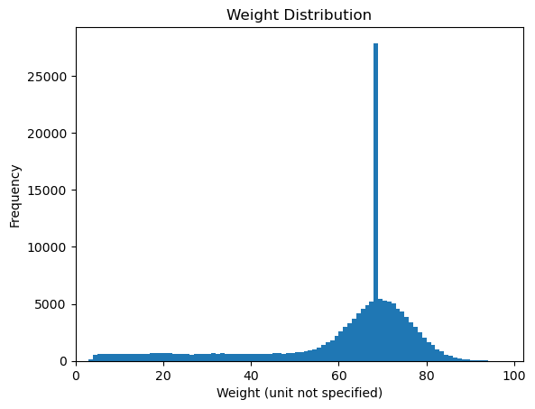
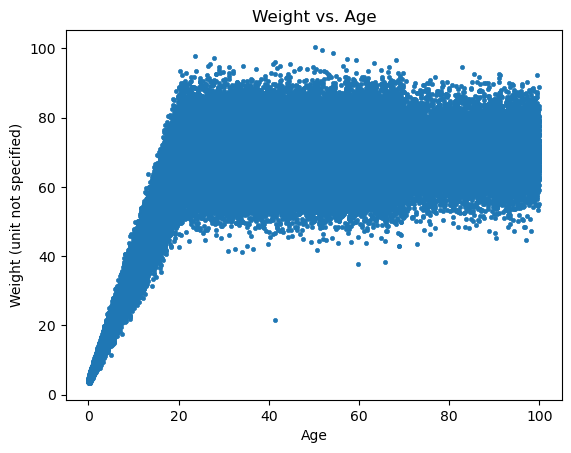

# Studio 1 — Standards Exercises

[Back to course portfolio](../README.md)

**Course:** BIS/CBB 634 — Computational Methods for Informatics, Fall 2026  
**Author:** Liam Lian (xl758)

This folder contains both exercises for Studio 1. Exercise 1 covers COVID-19 case data; Exercise 2 uses `population.json` to analyze population data.

## Exercise 1 — COVID-19 Case Data

The analysis loads cumulative state-level counts, calculates daily reported changes, compares state trends and peak dates, and investigates Florida reporting anomalies.

## Code and outputs

- [Jupyter notebook](studio-01-covid.ipynb): executable Python code and saved outputs for tasks 1a–1e.
- [Overlaid state plot](daily_cases.png).
- [Florida plot](florida_daily_cases.png).
- [Data download helper](download_data.py): retrieves and verifies the input file.

The notebook is the maintained analysis source. The supplied assignment does not explicitly require a `.py` extension; its references to code and scripts are implemented here as Python notebook cells.

## Reproduce the analysis

From the `standard-exercises` folder, in a Python environment with pandas, matplotlib and Jupyter installed:

```bash
python download_data.py
jupyter notebook studio-01-covid.ipynb
```

Restart the notebook kernel and run all cells in order. The download helper uses only the Python standard library. It writes `us-states.csv`, preserving the notebook's relative path, and verifies SHA-256 before accepting the file. The full upstream archive is retained in the local course source directory; only state-level data is needed here. The input CSV is downloaded into this exercise folder and is not tracked in Git. Existing matching data can be used without downloading again.

## Data source and preparation — 1a

Data source: **The New York Times**, [Coronavirus (Covid-19) Data in the United States](https://github.com/nytimes/covid-19-data), specifically [us-states.csv](https://github.com/nytimes/covid-19-data/blob/master/us-states.csv). Consult the upstream [README](https://github.com/nytimes/covid-19-data/blob/master/README.md) and [license](https://github.com/nytimes/covid-19-data/blob/master/LICENSE) for methodology and usage terms. The upstream project states that daily case/death updates stopped March 24, 2023.

The analyzed snapshot contains 61,942 rows across 56 state/territory-level labels, spanning January 21, 2020 through March 23, 2023. `cases` and `deaths` are cumulative reported counts. Dates are parsed as datetime values, and FIPS codes remain strings so leading zeros are retained.

Rows are sorted by state and date. `groupby("state")["cases"].diff()` computes daily changes once during preparation. `daily_cases` uses pandas nullable `Int64`: each group's first record has no prior observation and stays missing, producing 56 missing differences. Missing values are not replaced with zero. Negative changes are retained as possible reporting revisions.

Input SHA-256: `0b202f6ac8bad66b70b9e344c07155e3f1ce9338f86192af072b56ce448dfc43`.

## State trends — 1b

`plot_daily_cases(data, states)` overlays selected states. Connecticut is blue, New York orange, and Florida green in the example. Florida's standalone plot is explicitly recolored green for consistency. Date labels use `YYYY-MM`, spaced every three months and rotated for readability.



These are absolute reported changes, not population-adjusted rates. Reporting delays and revisions can create spikes or negative values; the curves do not directly measure infection dates. Raw daily values preserve these patterns but are noisy, and larger spikes compress smaller curves on the shared axis.

## Peak dates and comparison — 1c–1d

`find_peak_date(data, state)` selects the date of the largest daily change. Sorting by date means ties resolve to the earliest occurrence. `compare_peak_dates(data, state1, state2)` compares the two dates and returns the absolute number of elapsed days while printing which state peaked first.

| State | Peak report date | Daily reported change |
| --- | --- | ---: |
| Connecticut | 2022-01-10 | 31,405 |
| New York | 2022-01-08 | 90,132 |
| Florida | 2022-01-04 | 193,786 |

The notebook's Connecticut–Florida example finds that **Florida peaked 6 days before Connecticut**. This comparison concerns peaks in reported increments; it does not establish the ordering of actual infection peaks.

## Florida anomalies — 1e



I noticed one negative daily change in Florida's case data: −40,527 on June 4, 2021. This might reflect a revision or correction to previously reported cumulative counts.

I also noticed three consecutive days with zero reported increase immediately before the peak. From January 1 through January 3, 2022, the cumulative count stayed at 4,166,392. On January 4, it increased by 193,786, producing the largest daily increase in the dataset for Florida.

My hypothesis is that reporting may have been delayed during the New Year's holiday period, with cases from the preceding days reported together on January 4. If so, the peak could partly reflect a reporting backlog rather than infections occurring on a single day. The three zero increases describe unchanged reported totals, not necessarily an absence of new cases. This holiday-related explanation is a hypothesis based on the pattern; I have not verified the reporting schedule.

## Code evolution and design choices

During the in-class discussion, I discussed loading and inspecting the CSV, implementing plotting and peak-comparison functions, parsing dates explicitly, and storing FIPS codes as strings. I also discussed formatting the date axis as `YYYY-MM` and keeping Florida's color consistent between the combined and standalone plots. These choices are reflected in my notebook.

After noticing that `.diff()` produced floating-point values, I proposed calculating `daily_cases` once in the initial preparation cell and reusing it throughout the analysis. I used nullable integers to preserve the missing first observation for each state. This keeps the transformation in one place and avoids repeated calculations.

I pass the prepared DataFrame into the functions, so the preparation cell must run first. I keep raw daily differences, including negative values, to make reporting patterns and possible revisions visible. The trade-off is that the plots remain noisy and their peaks may reflect reporting delays. I compare absolute counts rather than population-adjusted rates, so the plots do not directly compare individual risk across states.

## AI assistance

I used OpenAI Codex to assist with code generation, README writing, and code maintenance. I also discussed some ideas with Codex during development. I made the overall decisions, selected the chart types in line with the assignment requirements, and developed the substantive answers and interpretations. Codex helped implement and express these choices, while I retained responsibility for the final work.

## Exercise 2 — Population Data

To run Exercise 2, download `population.json` from the course's [Canvas data file](https://yale.instructure.com/courses/121398/files/13008976), place it directly in this folder, and open [the population notebook](studio-01-population.ipynb.ipynb). Run its cells in order. The original JSON remains local and is not tracked in Git; access to the course file requires Canvas authorization.

### 2a — Data structure

I loaded `population.json` using Python's built-in `json` module. The dataset contains **152,361 individual records**, stored as a list of dictionaries. Each record has four top-level keys:

| Key | Contents |
| --- | --- |
| `id` | Individual identifier |
| `demographics` | Nested dictionary containing `age`, `household_income_band`, and `eyecolor` |
| `name` | Individual's name |
| `last_measurements` | Nested dictionary containing `weight` and `temperature` |

The nested structures are dictionaries, not lists. I access age through `person["demographics"]["age"]`.

### 2b — Age distribution

I extracted the age values and calculated the following descriptive statistics (rounded to two decimal places):

| Statistic | Age (years) |
| --- | ---: |
| Mean | 39.51 |
| Population standard deviation (`ddof=0`) | 24.15 |
| Minimum | 0.00 |
| Maximum | 99.99 |

The displayed minimum is rounded and does not necessarily indicate an exact age of zero.



I first inspected the histogram with the default, wider bins, then compared it with **1-year bins** (100 bins spanning 0–100 years). I chose the 1-year bin width because it preserves the overall distribution visible with wider bins while revealing smaller differences in frequency between adjacent age groups. These variations remain small enough that they do not obscure the general pattern. Wider bins provide a useful overview, but combine several ages and hide some of this detail.

The most prominent pattern is a sharp decrease in frequency at **age 70**. Counts are relatively similar across the 1-year groups below 70, then remain at a much lower, roughly stable level from 70 onward. I added a vertical dashed line at 70 and labeled this age on the x-axis to highlight the boundary between the 69–70 and 70–71 age groups. The line marks an observed feature of the histogram; it does not establish the cause of the decrease. The histogram does not show a clearly isolated age outlier.

Code and saved outputs: [population notebook](studio-01-population.ipynb.ipynb). Sections 2a–2d are documented here.

### 2c — Weight distribution

I extracted weights from `person["last_measurements"]["weight"]`. The summary statistics, rounded to two decimal places, are:

| Statistic | Weight (unit not specified) |
| --- | ---: |
| Mean | 60.88 |
| Population standard deviation (`ddof=0`) | 18.41 |
| Minimum | 3.38 |
| Maximum | 100.44 |



The observed weights range from approximately **3.38 to 100.44**. I chose a histogram range of **0–102** to start the axis at zero and include all observations. I divided this range into **102 equal-width bins**, giving each bin a width of **1**. The weight unit is not specified in the supplied data, so I have not labeled it as kilograms or another unit.

After inspecting wider bins, I chose this narrower bin width because it preserves the overall distribution while showing smaller differences in frequency between adjacent intervals bounded by consecutive integers. These details do not make the general pattern difficult to recognize. The 1-unit bins also make the highest-frequency interval easier to locate; wider bins combine neighboring intervals and can obscure a narrow concentration of observations. This identifies an interval with the highest frequency, not an exact most frequent weight value.

The histogram shows a broad concentration around **60–80**, with a sharp spike visually near **68–69** that stands well above the neighboring bins. This narrow spike was less apparent with wider bins. Lower weights form a relatively low, extended tail, while frequencies decrease toward the upper end of the observed range. Although the minimum and maximum lie far from the main concentration, I do not classify individual records as anomalous from this histogram alone. The reason for the sharp spike has not yet been established.
### 2d — Age–weight relationship and outlier isolation



**Trend analysis.** From approximately ages 0 to 20, weight generally increases with age, a pattern consistent with growth during childhood and adolescence. After about age 20, most weight values fall between 50 and 90, with no clear overall increase or decrease as age advances. Some observations lie outside this range.

**Identification and search.** I first noticed a clearly isolated point in the scatterplot at approximately age 42 and weight 21. Either value on its own is within the dataset's range, but their combination is unusual relative to the main adult cluster. Other points near the edges generally follow the broader pattern, so I did not classify them as outliers based on this plot alone.

To retrieve the individual, I filtered records for ages **35–50** and weights **below 30**. These bounds were chosen after inspecting the plot to locate the observed point; they are not a general statistical outlier rule or independent proof of abnormality. The filter returned one record:

| Name | Age (years) | Weight (unit not specified) |
| --- | ---: | ---: |
| Anthony Freeman | 41.30 | 21.70 |

My process was to inspect the joint distribution, identify the isolated age–weight combination, define a search region around it, and retrieve the matching name and measurements. I used this visual inspection and filtering approach rather than fitting a statistical model or applying a standard-deviation cutoff.

**Interpretation.** This example shows why examining variables together can reveal an unusual record that separate age and weight histograms might miss. The record warrants checking against the original source and measurement context. It could represent an unusual observation or a data problem; the plot alone does not establish which, so I have not removed or corrected it.

### Exercise 2 — Code evolution and design choices

I began by loading the JSON and inspecting its nested dictionaries, then extracted ages and weights into arrays for descriptive statistics and plotting. I used population standard deviations (`ddof=0`) to describe the records in this dataset.

I first viewed basic histograms with wider bins, then refined the binning after inspecting the plots. I chose 1-year age bins to retain the overall pattern while showing differences between adjacent age groups. I added a dashed reference line and an x-axis label at age 70 to highlight the largest drop between neighboring bins. I also placed the bin definition before the histogram calculation so the cell can run in order.

For weights, I chose a 0–102 plotting range and 102 bins of width 1. This includes the full observed range, starts the axis at zero, and reveals a narrow peak that wider bins obscure. These choices improve detail while keeping the broad distribution recognizable, although the tallest bin depends on the selected bin boundaries.

I then plotted weight against age and reduced the scatter-marker size to `s=9`, with `linewidths=0.5`, to reduce overlap. All observations remain plotted, so dense regions can still obscure individual points. Finally, I used a visual search region to retrieve the isolated record. This directly addresses the exercise's identification task but is not a general-purpose anomaly-detection method.

### Exercise 2 — AI assistance

I used OpenAI Codex to assist with code generation, README writing, and code maintenance. I also discussed ideas with Codex, including bin widths, the age-70 boundary, marker sizing, and the distinction between locating an observed point and defining a statistical outlier rule. I made the overall decisions, selected the chart types in line with the assignment requirements, and developed the substantive answers and interpretations. Codex helped implement and express these choices, including the filtering code, while I retained responsibility for the final work.
